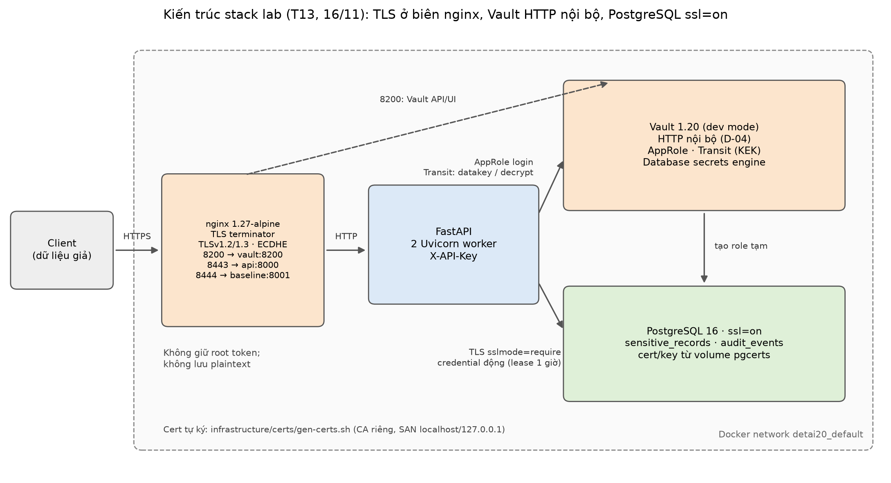
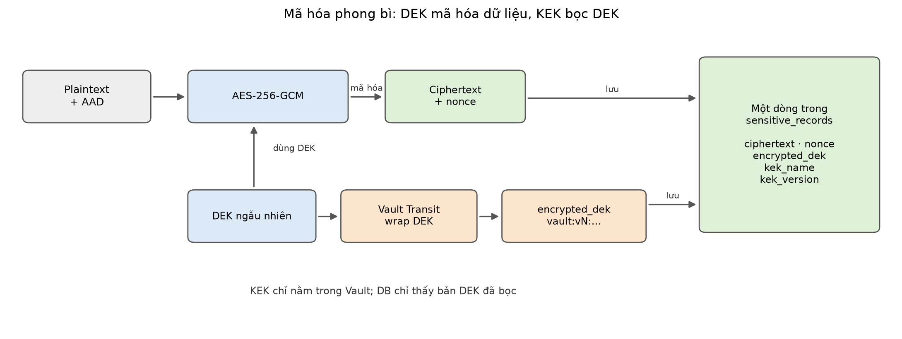
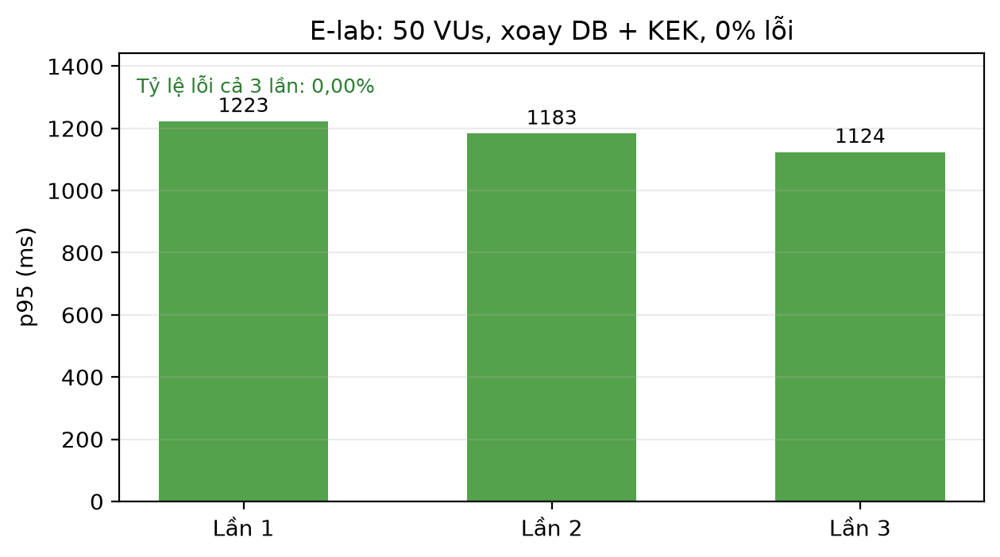
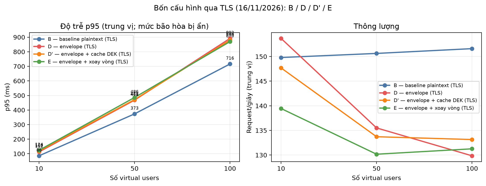

## PHẦN MỞ ĐẦU

### 1. Tính cấp thiết

Dữ liệu trên nền tảng đám mây được bảo vệ ở ba trạng thái: khi truyền (in transit), khi lưu trữ (at rest) và khi xử lý (in use) [2], [7]. Nhiều sự cố rò rỉ không đến từ thiếu thuật toán mã hóa mà từ quản lý khóa và secret sai: mật khẩu database hardcode trong mã nguồn, token nằm trong lịch sử Git, khóa lưu cùng nơi với dữ liệu, hoặc ứng dụng có quyền giải mã quá rộng [8]. Khi kẻ tấn công lấy được cả ciphertext lẫn khóa, mã hóa gần như mất giá trị bảo vệ.

Câu hỏi của đề tài vì vậy không phải "dùng thuật toán nào" mà là "quản lý khóa, secret và quyền giải mã thế nào để mã hóa thực sự có tác dụng" [1]. Đồ án trả lời bằng một nguyên mẫu đo lường được: API lưu thông tin nhạy cảm dùng mã hóa phong bì (envelope encryption), HashiCorp Vault quản lý khóa và cấp credential động, cùng đường ống DevSecOps kiểm soát secret trong mã nguồn.

### 2. Mục tiêu cụ thể

1. Mã hóa phong bì tầng ứng dụng: DEK ngẫu nhiên mỗi bản ghi, AES-256-GCM, DEK được Vault Transit bọc bằng KEK [3], [4], [9].
2. Loại bỏ mật khẩu database tĩnh bằng Vault Database Secrets Engine và AppRole [5], [6].
3. Thiết lập vòng đời bí mật: tạo, phân phối, xoay vòng, thu hồi, audit.
4. Chứng minh tính liên tục khi xoay: credential mới được kiểm tra trước khi chuyển pool, credential cũ giữ đến hết lease.
5. Kiểm chứng bằng bộ ca T01–T16 và đo hiệu năng k6 ở 10/50/100 VUs so với baseline plaintext, qua TLS.
6. Tích hợp cổng bảo mật CI (Gitleaks), quy tắc bảo vệ nhánh và cảnh báo bất thường từ audit log.

### 3. Phương pháp luận

Thực nghiệm kiểm soát biến trên cùng một máy lab:

- **Baseline B:** API tối giản lưu plaintext, cùng PostgreSQL, không gọi Vault, đặt sau cùng TLS terminator với target.
- **Target D / D' / E:** ứng dụng thật với envelope encryption; D' bật cache DEK 120 s; E xoay credential DB và KEK trong cửa sổ đo.
- **Đo lường:** k6 `constant-vus` 10/50/100 VUs, 5 lần × 3 phút mỗi mức, warm-up 1 phút; lấy trung vị p95 giữa các lần.
- **Kiểm chứng an toàn:** T01–T16 gồm round-trip, tamper, AAD binding, phân quyền, audit, quét secret, quy tắc nhánh, TLS, tái lập và cảnh báo.

Số liệu trước khi có TLS (31/10–11/11) được giữ nguyên nhãn `A`, `D-lab`, `E-lab` trong Phụ lục B làm mốc lịch sử, không trộn với số liệu TLS mới.

### 4. Đóng góp và giới hạn

Đóng góp: nguyên mẫu chạy được với bằng chứng thực thi cho từng tuyên bố bảo mật; bộ công cụ tái lập (compose, script Vault, k6, checker quyền, cảnh báo audit); ma trận đo bốn cấu hình qua TLS. Giới hạn: lab một máy cá nhân, Vault dev mode một nút, at-rest cấp volume được chấp nhận rủi ro bằng văn bản (BitLocker Off), số liệu hiệu năng chỉ có ý nghĩa tương đối. Các defect D-01–D-09 công khai thay vì che giấu.

## CHƯƠNG 1: CƠ SỞ LÝ THUYẾT VÀ CÔNG NGHỆ BẢO MẬT ĐÁM MÂY

### 1.1. Ba trạng thái dữ liệu cần bảo vệ

**Data in transit.** TLS 1.2/1.3 chống nghe lén và man-in-the-middle; TLS bảo vệ kênh, không bảo vệ bộ nhớ hay ổ đĩa của ứng dụng. Đồ án kết thúc TLS tại nginx cho cả ba biên Vault/API/baseline (mục 3.1).

**Data at rest.** Mã hóa volume (BitLocker, LUKS, EBS encryption) hoặc TDE bảo vệ khi ổ đĩa bị mất hay sao chép trái phép; nếu khóa giải mã nằm cùng máy chủ, lớp này vô hiệu khi toàn hệ thống bị xâm nhập [3].

**Data in use / application-level.** Mã hóa ngay tại ứng dụng trước khi ghi database; bảo vệ cả khi database bị đọc trộm, miễn khóa giải mã không nằm trong database. Đây là lớp đồ án triển khai.

### 1.2. Mã hóa phong bì và phân cấp khóa

Hai tầng khóa [3], [4]:

- **DEK:** khóa đối xứng ngắn hạn, sinh mới mỗi bản ghi, mã hóa dữ liệu bằng AES-256-GCM [9].
- **KEK:** khóa lâu dài trong KMS/HSM, chỉ dùng bọc DEK; ứng dụng lưu `encrypted_dek`, không lưu KEK.

Luồng ghi: (1) gọi Transit `datakey/plaintext` sinh DEK 256 bit; (2) Vault trả plaintext DEK và ciphertext của DEK; (3) mã hóa AES-256-GCM, nonce 12 byte, AAD `record_id:record_type`; (4) lưu `ciphertext`, `nonce`, `encrypted_dek`, `kek_name`, `kek_version`. Luồng đọc: đọc bản ghi → gửi `encrypted_dek` tới Transit `decrypt` → giải mã AES-GCM; sai ciphertext/nonce/AAD/DEK đều thất bại.

Ưu điểm: dữ liệu lớn không gửi lên KMS; KEK không rời Vault; mỗi bản ghi một DEK nên lộ một DEK không lộ toàn bộ database. Nhược điểm: mỗi thao tác cần một lệnh gọi mạng tới Vault — chi phí đo được ở mục 4.4.

### 1.3. KMS/HSM và quản trị bí mật

**KMS** quản lý vòng đời khóa: tạo, phiên bản hóa, xoay, vô hiệu, xóa. **HSM** bảo vệ khóa cả khi máy chủ bị xâm nhập; Vault có thể seal bằng Shamir shares hoặc dùng HSM. Lab dùng dev mode một root token, không HSM — giới hạn ghi nhận ở Chương 5.

**Secret động** là credential sinh theo yêu cầu, có lease, thay mật khẩu tĩnh: Vault Database Secrets Engine tạo role PostgreSQL tạm với TTL và tự thu hồi khi hết hạn hoặc bị revoke, thu hẹp cửa sổ tấn công [5].

**Phân tách trách nhiệm:** quản trị database không nắm quyền giải mã; quản trị KMS không đọc dữ liệu; ứng dụng chỉ được sinh DEK, giải mã DEK, đọc credential DB — không xoay KEK, không đọc metadata khóa, không export khóa [6].

**Crypto-shredding:** xóa KEK khiến mọi `encrypted_dek` vô dụng; dữ liệu không giải mã được dù ciphertext còn.

### 1.4. Rủi ro lộ bí mật và audit trail

Bề mặt rò rỉ phổ biến [8]: mã nguồn và lịch sử Git; Docker image layers chứa `.env`/credential; log ghi plaintext/token/DSN; biến môi trường lộ qua dump lỗi; quyền giải mã quá rộng hoặc token không hết hạn. Audit trail của Vault ghi mọi request (token/accessor đã băm) gồm đường dẫn, danh tính, thời gian, kết quả; đồ án dùng audit file device và script ngưỡng 200 request decrypt/60 giây (T16).

### 1.5. Tiêu chuẩn tham chiếu

Báo cáo bám NIST SP 800-57 [3], NIST SP 800-145 [2], NIST SP 800-38D [9] và tài liệu Vault Transit/Database/AppRole [4]–[6]. Khuyến nghị TLS, least privilege và audit vận dụng ở mức lab; không tuyên bố tuân thủ đầy đủ FIPS/PCI DSS.

## CHƯƠNG 2: THIẾT KẾ KIẾN TRÚC VÀ RANH GIỚI BẢO MẬT

### 2.1. Phân loại dữ liệu và bề mặt tấn công

Hệ thống mô phỏng API quản lý thông tin khách hàng, chỉ lưu dữ liệu giả.

**Bảng 1. Phân loại dữ liệu và yêu cầu bảo vệ**

| Cấp độ | Ví dụ trường | Rủi ro khi bị xâm phạm | Yêu cầu bảo vệ |
|---|---|---|---|
| Công khai | Tên dịch vụ, mô tả | Thấp | Không cần mã hóa |
| Nội bộ | ID bản ghi, thời gian tạo, loại bản ghi | Ảnh hưởng cấu trúc nội bộ | Kiểm soát truy cập API |
| Nhạy cảm | Số điện thoại, địa chỉ, email | Xâm phạm quyền riêng tư | TLS + mã hóa lưu trữ |
| Bí mật | CCCD, số thẻ, số dư | Hậu quả pháp lý/tài chính | Envelope encryption cấp ứng dụng |

Trường `value` (ví dụ `0901234567`) thuộc nhóm nhạy cảm/bí mật, luôn mã hóa trước khi ghi; `record_type`, `id`, `created_at` là metadata nội bộ bảo vệ bằng API key và quyền database. Bề mặt tấn công: API công khai (thiếu/sai key, lạm dụng admin); ứng dụng (lộ DSN, token, plaintext trong log); Vault (root token, policy rộng, secret ID không hết hạn); database (role quá quyền, backup chứa metadata); CI/Git (secret trong commit/image); vận hành (xoay khóa sai thứ tự).

### 2.2. Kiến trúc baseline (B)

Baseline chỉ dùng đo đạc: client gọi HTTPS tới nginx rồi tới API tối giản; API nối PostgreSQL bằng DSN tĩnh; trường nhạy cảm lưu plaintext trong `bench_plaintext_records`; mỗi ghi/đọc thêm một dòng `bench_plaintext_audit` để cùng khối lượng DB với target; không KMS, không mã hóa, không xoay vòng. Lỗ hổng: đọc được database là đọc được dữ liệu; mật khẩu tĩnh trong cấu hình; không bằng chứng ai giải mã; không thu hồi. Baseline không merge vào ứng dụng. Trước khi có TLS, baseline mang nhãn `A` (Phụ lục B).

### 2.3. Kiến trúc target (D) và ranh giới TLS

Thành phần: (1) client gửi `X-API-Key` qua **HTTPS** tới nginx; (2) nginx kết thúc TLS và chuyển tiếp HTTP nội bộ tới API FastAPI; (3) API xác thực key, gọi Vault, mã hóa/giải mã, ghi database; (4) Vault dev mode giữ Transit KEK `app-data-key` (AES-256-GCM96), Database Secrets Engine, AppRole `app`/`operator`, audit file; (5) PostgreSQL `ssl=on` lưu ciphertext/nonce/encrypted_dek/kek_name/kek_version và audit, không cột plaintext.

```text
Client --(HTTPS 8443, TLS 1.2/1.3)--> nginx --(HTTP nội bộ)--> FastAPI (2 worker)
FastAPI --(AppRole login)--> Vault (HTTP nội bộ, sau nginx 8200)
FastAPI --(datakey/plaintext | decrypt)--> Vault Transit --(KEK)--> wrapped DEK
FastAPI --(AES-256-GCM + AAD)--> ciphertext/nonce
FastAPI --(database/creds/app-role, sslmode=require)--> PostgreSQL (ssl=on)
Vault --(audit file)--> /tmp/vault-audit.log
```

{width=100%}

Ranh giới bảo mật: plaintext chỉ trong request/response và bộ nhớ API; KEK không rời Vault; credential DB động có TTL; endpoint quản trị cần admin key riêng; audit là nguồn sự thật phát hiện bất thường. TLS bảo vệ biên ngoài; đoạn nginx→Vault/API/PostgreSQL nằm trong mạng Docker nội bộ của một máy lab, được ghi nhận là giới hạn (mục 5.2).

### 2.4. Chính sách phân quyền và vòng đời bí mật

**Bảng 2. Quyền least privilege của AppRole workload**

| Path | Quyền | Mục đích |
|---|---|---|
| `transit/datakey/plaintext/app-data-key` | update | Sinh DEK |
| `transit/decrypt/app-data-key` | update | Giải mã DEK |
| `transit/rewrap/app-data-key` | update | Bọc lại DEK sau khi operator xoay KEK |
| `database/creds/app-role` | read | Credential DB động |
| `transit/keys/app-data-key/rotate` | **deny** | App không xoay KEK |
| `transit/keys/app-data-key` | **deny** | Không đọc metadata/version |
| `transit/export/app-data-key` | **deny** | Không export khóa |
| `transit/keys/app-data-key/config` | **deny** | Không sửa cấu hình khóa |

AppRole `operator` giữ rotate, đọc metadata, đặt `min_decryption_version`, cấp SecretID mới và không được mount vào API. SecretID workload có `secret_id_ttl=10m`, `secret_id_num_uses=1`. T06 nghiệm thu ĐẠT 05/11/2026: `check_approle_privileges.py` in PASS cho 5 path cấm và 4 path bắt buộc rồi exit 0; `prove_rotate_forbidden.py` và endpoint `/admin/rotation/transit-key` đều trả 403 với danh tính workload; tái kiểm chứng độc lập 11/11 (`T06_T08_T15_2026-11-11.md`).

Vòng đời bí mật 5 bước: **tạo** (`setup_vault.py` chạy một lần trong `vault-init`); **phân phối** (AppRole login từ volume `/credentials`, token TTL); **xoay** (credential DB kiểm tra trước khi chuyển pool, pool cũ giữ đến hết lease; operator xoay KEK, workload rewrap, operator đặt `min_decryption_version`); **thu hồi** (revoke lease, hủy SecretID lộ); **audit** (ghi mọi request Transit/Database, cảnh báo vượt ngưỡng).

**Bảng 3. Mô hình đe dọa và bằng chứng**

| Đe dọa | Biện pháp | Bằng chứng |
|---|---|---|
| Đọc trộm database | Ciphertext + DEK bọc bởi KEK trong Vault | T01, T02, T03 |
| Tráo ciphertext giữa bản ghi | AAD `record_id:record_type` | T04 |
| Dùng API không có quyền | API key + admin key riêng, fail-closed | T05 |
| AppRole lạm dụng xoay/export khóa | Policy least privilege; rotate thuộc operator | T06 |
| Xoay khóa làm mất dữ liệu | Giữ version cũ, rewrap, min version | T08 |
| Credential DB bị lộ | Dynamic secret + lease TTL/revoke | T09, T10 |
| Secret trong Git/image | Gitleaks + `.dockerignore` + CI | T11, T12 |
| Nghe lén đường truyền | TLS 1.2/1.3 tại nginx, PG `ssl=on` | T13 |
| Giải mã bất thường | Audit + cảnh báo 200/phút | T16 |

## CHƯƠNG 3: HIỆN THỰC HÓA NGUYÊN MẪU VÀ TỰ ĐỘNG HÓA LAB

### 3.1. Môi trường, hạ tầng dưới dạng mã và TLS

Stack lab (`docker-compose.yml`): `postgres` 16-alpine (`ssl=on`, cert/key từ volume `pgcerts`), `vault` 1.20 dev mode, `vault-audit` bật file audit, `vault-init` cấu hình một lần, `api` FastAPI 2 Uvicorn worker, `pgcerts` one-shot copy cert với quyền 600/chown 70:70 (bind mount Windows không đạt permission khóa riêng của PostgreSQL), và `nginx` 1.27-alpine kết thúc TLS. Chứng chỉ tự ký sinh bằng `infrastructure/certs/gen-certs.sh` (CA lab riêng, SAN `localhost,127.0.0.1,vault,api,postgres`, hạn 365 ngày); thư mục `certs/out/` bị gitignore, chỉ script được commit.

**Bảng 4. Cổng công bố của stack lab**

| Cổng | Đích | Giao thức | Ghi chú |
|---:|---|---|---|
| 8443 | nginx → api:8000 | HTTPS | Biên chính của ứng dụng |
| 8444 | nginx → baseline:8001 | HTTPS | Chỉ khi đo baseline B |
| 8200 | nginx → vault:8200 | HTTPS | Biên quản trị Vault |
| 8000 | api:8000 | HTTP | Fallback debug lab, không phải biên production |

Vault giữ HTTP trong mạng Docker nội bộ (chủ đích, D-04): TLS đặt ở biên ngoài để không phá vỡ AppRole/Transit và không cần tự động hóa unseal. Biến thể production-intent (`infrastructure/docker-compose.yml`, Vault file storage + TLS nội bộ) được giữ làm tài liệu thiết kế, chưa nghiệm thu.

Biện pháp tránh lộ secret: `.dockerignore` loại `.env`, `vault-credentials.json`, venv, cache; chỉ `vault-init` nhận root token và mật khẩu DB admin; `.env`/credential gitignore, CI quét toàn bộ lịch sử; API key/admin key chỉ đọc từ môi trường (PR #9): compose dùng `${API_KEY:?...}` nên thoát ngay khi thiếu biến, `lifespan` raise `RuntimeError` nếu key rỗng, `hmac.compare_digest` trả `False` khi key cấu hình thiếu nên không request nào khớp khóa trống; `.env.example` chỉ chứa tên biến và lệnh sinh khóa.

### 3.2. Module mã hóa phong bì

Đoạn mã chính trong `app/services/encryption.py` (trích nguyên văn trong Phụ lục A):

```python
response = client.secrets.transit.generate_data_key(
    name=settings.vault_transit_key, key_type="plaintext", bits=256,
    mount_point=settings.vault_transit_mount)
dek = base64.b64decode(response["data"]["plaintext"], validate=True)
encrypted_dek = response["data"]["ciphertext"]
nonce = os.urandom(12)
ciphertext = encrypt_with_dek(plaintext=plaintext, dek=dek, nonce=nonce,
                              aad=associated_data(record_id, record_type))
```

{width=90%}

DEK 32 byte, nonce 12 byte, AES-256-GCM cho confidentiality và integrity [9]; AAD gắn ciphertext với `record_id:record_type` nên tráo payload thất bại (T04); `encrypted_dek` dạng `vault:vN:...` và `kek_version` lưu để truy vết; giải mã lỗi ghi audit `decrypt_failed` và trả 503, không lộ chi tiết nội bộ. Schema `sensitive_records` không có cột plaintext — bằng chứng cấu trúc cho T01/T02.

### 3.3. Workload identity và credential động

`vault_client.py` đọc `role_id`/`secret_id` từ volume, đăng nhập AppRole; không root token trong tiến trình API. `database.py` hỗ trợ `USE_VAULT_DB_CREDS=false` (DSN tĩnh, mặc định lab) và `true` (gọi `database/creds/app-role`, engine SQLAlchemy từ credential động, `pool_recycle` ngắn hơn lease, `SELECT 1` trước khi dùng, `sslmode=require`). Xoay vòng tạo engine mới rồi đổi con trỏ dưới lock; pool cũ `dispose(close=False)` để connection đang xử lý tiếp tục dùng credential cũ đến hết lease — cửa sổ chồng lấn có chủ đích tránh 5xx khi xoay dưới tải (T09), đổi lại tồn tại hai credential hợp lệ trong cửa sổ đó và phải thu hồi lease cũ khi hết hạn. Pool mặc định 20+20 và 2 worker (D-08 đã đóng); cơ chế đổi engine là process-local, scale ngang cần phối hợp riêng (mục 5.2).

### 3.4. Xoay vòng KEK và rewrap

`rotate_transit_key.py` (operator) gọi `transit/keys/app-data-key/rotate`; `rewrap_dek.py` (workload) gọi `transit/rewrap` và ghi version mới vào `encrypted_dek` không giải mã payload; `set_min_decryption_version.py` (operator) chặn version đã nghỉ hưu; `rotate_dek.py` là đường khác: giải mã rồi mã hóa lại bằng DEK mới. Quy trình T08 đủ 7 bước, nghiệm thu 05/11 và tái kiểm chứng 11/11: `kek_version` 1→2, prefix `vault:v1:`→`vault:v2:`, Vault trả 400 `version: 1, min_decryption_version: 2` khi giải mã DEK cũ.

### 3.5. DevSecOps: CI, quy tắc nhánh và cảnh báo

CI `.github/workflows/security-gate.yml`: job `gitleaks` checkout `fetch-depth: 0`, image `ghcr.io/gitleaks/gitleaks:v8.24.0`, config `.gitleaks.toml`, `--log-opts="--all" --exit-code 1`; job `unit-tests` Python 3.12 chạy `pytest -q`. Ruleset `main-1`: chặn xóa nhánh/force push, bắt buộc PR + 1 approval + hai check; tác giả không bypass (PR #5 từng bị chặn merge dù CI xanh). Cảnh báo `alert_decrypt_rate.py` đọc audit JSONL, đếm cửa sổ trượt 60 s theo danh tính, in `ALERT` exit 2 khi vượt 200; `generate_decrypt_load.py` tạo burst kiểm chứng. `smoke-test.ps1` kiểm 9 điểm gồm truy vấn thẳng PostgreSQL khẳng định không plaintext; `check_approle_privileges.py` kiểm quyền bằng `sys/capabilities-self`.

## CHƯƠNG 4: KẾT QUẢ THỰC NGHIỆM, ĐO LƯỜNG VÀ ĐÁNH GIÁ

### 4.1. Thiết kế thí nghiệm và hồ sơ tải

**Bảng 5. Môi trường đo (16/11/2026)**

| Thành phần | Cấu hình |
|---|---|
| Máy | Windows 11 Home, AMD Ryzen 9 7940HS, 16 GB RAM, Docker Desktop |
| Ứng dụng | FastAPI + Uvicorn 2 worker, SQLAlchemy 2, psycopg 3, pool 20+20 |
| TLS | nginx 1.27-alpine, TLSv1.2/1.3, chứng chỉ tự ký của CA lab |
| Database | PostgreSQL 16 Alpine, `ssl=on`, volume local |
| Vault | HashiCorp Vault 1.20 dev mode, HTTP nội bộ sau nginx |
| k6 | grafana/k6:0.54.0 trong Docker, `insecureSkipTLSVerify` cho CA lab |
| Dữ liệu | Giá trị tổng hợp `090xxxxxxx`, `record_type = bench_phone` |

Kịch bản k6: 70% POST `/records`, 30% GET `/records/{id}` của bản ghi tạo trong `setup()`. Ma trận bốn cấu hình: **B** (baseline plaintext sau TLS), **D** (envelope, cache DEK 0), **D'** (envelope, `DEK_CACHE_TTL_SECONDS=120`), **E** (D + xoay credential DB ở giây 60 và xoay KEK trong cửa sổ 3 phút). Mỗi cấu hình 5 lần × {10, 50, 100} VUs × 3 phút, warm-up 1 phút không ghi CSV, restart API trước mỗi cấu hình; trung vị p95 giữa các lần; CSV thô nén lossless kèm `_summary.json`. Orchestrator `bench/run_matrix.sh` chạy tuần tự, không song song hai cấu hình.

**Cấu hình C không đo:** probe UAC ngày 16/11 cho `Protection Off` ở cả C: và D:; theo quyết định đã duyệt, at-rest cấp volume được **chấp nhận rủi ro bằng văn bản** thay vì tự bật BitLocker trên máy cá nhân. T14 vì vậy vẫn "đạt một phần" cho C, ghi rõ lý do.

### 4.2. Kết quả kiểm thử chức năng và bảo mật

**Bảng 6. Kết quả bộ ca T01–T16**

| Ca | Nội dung | Kết quả | Bằng chứng |
|---|---|---|---|
| T01 | Envelope round-trip | ĐẠT | `T01_T05_T07_2026-10-31.md` |
| T02 | Không plaintext trong DB/dump/log/image | ĐẠT (4 vị trí đều 0) | `T02_plaintext_probe_2026-10-31.md` |
| T03 | Ciphertext bị sửa → 503 + audit | ĐẠT | `T03_T04_tamper_2026-10-31.md` |
| T04 | AAD binding, tráo payload → 503 | ĐẠT | cùng tệp |
| T05 | API key/admin key | ĐẠT (401/401/403) | `T01_T05_T07_2026-10-31.md` |
| T06 | AppRole least privilege | ĐẠT 05/11, tái kiểm chứng 11/11 | `T06_T08_2026-11-05.md`; `T06_T08_T15_2026-11-11.md` |
| T07 | Audit Transit/Database, 0 plaintext | ĐẠT | `T01_T05_T07_2026-10-31.md` |
| T08 | Xoay KEK + rewrap + chặn version cũ | ĐẠT 05/11, tái kiểm chứng 11/11 | `T06_T08_2026-11-05.md`; `T06_T08_T15_2026-11-11.md` |
| T09 | Xoay credential DB dưới tải | ĐẠT (0 lỗi) | `T09_T10_db_credentials_2026-10-31.md`; `E-lab_rotation_2026-10-31.md` |
| T10 | Lease renew/revoke | ĐẠT | cùng tệp |
| T11 | Gitleaks lịch sử + secret giả | ĐẠT (0 leak; fake bị bắt) | `T11_T12_2026-10-31.md` |
| T12 | Ruleset bảo vệ `main` | ĐẠT (PR + 1 approval + 2 check) | cùng tệp; 4 ảnh ruleset/PR/push |
| T13 | TLS + at rest | ĐẠT phần TLS 16/11; at-rest risk-accepted | `T13_2026-11-16.md` |
| T14 | Benchmark 10/50/100 VUs | ĐẠT B/D/D'/E 16/11; C không đo (risk-accepted) | `bench/results/`, mục 4.4 |
| T15 | Dọn tài nguyên/tái lập | ĐẠT (31/10 và 11/11 từ `main` sạch) | `T15_reproducibility_2026-10-31.md`; `T06_T08_T15_2026-11-11.md` |
| T16 | Cảnh báo decrypt bất thường | ĐẠT | `T16_alert_2026-10-31.md` |

Bằng chứng nổi bật: `sensitive_records` chỉ có ciphertext 26 byte, nonce 12 byte, `encrypted_dek` prefix `vault:v1:` (T01); sửa một byte hoặc tráo payload đều 503 kèm audit `decrypt_failed` (T03/T04); thiếu key 401, app key gọi admin 403, thiếu key cấu hình thì API từ chối khởi động (T05); stack dựng lại sạch 11/11 cho `vault-init` exit 0 và smoke 9/9 (T15); Gitleaks 0 leak và bắt token giả bằng rule `github-pat` (T11); T16 tải nền 1.478 request/10 phút không báo nhầm, burst 200 decrypt bị bắt trong 0,4 s.

**Bảng 7. Trạng thái defect D-01–D-09**

| Mã | Mô tả | Trạng thái 16/11/2026 | Người sửa |
|---|---|---|---|
| D-01 | Policy workload bỏ rotate/metadata; operator giữ vòng đời khóa | ĐẠT 05/11 | SV2 |
| D-02 | SecretID 10 phút, 1 lần dùng | ĐẠT 05/11 | SV2 |
| D-03 | Rewrap + `min_decryption_version` | ĐẠT 05/11 | SV2 |
| D-04 | Vault dev mode, HTTP nội bộ, root token lab | Risk-accepted, không production | SV1/SV3 |
| D-05 | `vault_admin` bỏ SUPERUSER; `SET FALSE` khi grant `app_writer` | Đóng trong mã 15/11 (PR #14); nghiệm thu lại 16/11 trên volume sạch: `admin_option=t, set_option=f` | SV2 |
| D-06 | `.vscode/settings.json` bỏ khỏi Git | Đã đóng | SV2 |
| D-07 | Baseline plaintext dựng riêng | Chỉ đo H1, không merge | SV3 |
| D-08 | Pool 20+20, 2 worker, trả connection trước khi gọi Vault; cache DEK tắt mặc định | Đóng trong mã 15/11; đo lại 16/11 | SV2 |
| D-09 | `generate_secret_id` truyền keyword hvac không nhận → `vault-init` exit 1 | Đã sửa + regression test 11/11 | SV3 |

### 4.3. Tính liên tục khi xoay vòng

T09: k6 20 VUs/1 phút, xoay credential ở giây 20 → 6.399 request, checks 100%, `http_req_failed = 0,00%`, p95 250,52 ms; API trả `status=rotated`, lease mới 3600 s; role cũ còn hiệu lực đến hết lease (overlap có chủ đích). E-lab (31/10, chưa TLS): 3 lần 50 VUs/3 phút, trung vị 77,34 RPS, p95 1.183,01 ms, 0,00% lỗi, 6 thao tác xoay HTTP 200 trong 0,164–0,517 s. E mới (16/11, qua TLS) lặp lại thiết kế đó với xoay credential ở giây 60 và xoay KEK trong cửa sổ đo; kết quả ở mục 4.4.

{width=80%}

So với cách thủ công (đổi mật khẩu + restart API tạo cửa sổ 502/503), đồ án **chưa đo trực tiếp** downtime thủ công trên cùng máy nên không đưa con số 3–12 giây như kết quả thực nghiệm; kết luận định lượng chỉ là 0 lỗi, 0 phản hồi 5xx trong cửa sổ xoay. E-lab 31/10 chỉ xoay KEK chưa rewrap nên chứng minh "xoay không gián đoạn", chưa chứng minh "hoàn tất vòng đời khóa"; phần hoàn tất chứng minh riêng bằng T08. E mới chưa đặt `min_decryption_version` trong lúc k6 chạy (đặt trong lúc tải sẽ chặn bản ghi cũ và gây lỗi giả), nên vẫn giữ ranh giới kết luận đó.

### 4.4. Đo lường hiệu năng qua TLS và chi phí đánh đổi

**Bảng 8. Hiệu năng bốn cấu hình qua TLS (trung vị 5 lần chạy mỗi mức, 16/11/2026)**

| Mức tải | Cấu hình | RPS | p50 (ms) | p95 (ms) | p99 (ms) | Error rate |
|---:|---|---:|---:|---:|---:|---:|
| 10 VUs | B | @@B_RPS_10@@ | @@B_P50_10@@ | @@B_P95_10@@ | @@B_P99_10@@ | @@B_ERR_10@@ |
| 10 VUs | D | @@D_RPS_10@@ | @@D_P50_10@@ | @@D_P95_10@@ | @@D_P99_10@@ | @@D_ERR_10@@ |
| 10 VUs | D' | @@DP_RPS_10@@ | @@DP_P50_10@@ | @@DP_P95_10@@ | @@DP_P99_10@@ | @@DP_ERR_10@@ |
| 10 VUs | E | @@E_RPS_10@@ | @@E_P50_10@@ | @@E_P95_10@@ | @@E_P99_10@@ | @@E_ERR_10@@ |
| 50 VUs | B | @@B_RPS_50@@ | @@B_P50_50@@ | @@B_P95_50@@ | @@B_P99_50@@ | @@B_ERR_50@@ |
| 50 VUs | D | @@D_RPS_50@@ | @@D_P50_50@@ | @@D_P95_50@@ | @@D_P99_50@@ | @@D_ERR_50@@ |
| 50 VUs | D' | @@DP_RPS_50@@ | @@DP_P50_50@@ | @@DP_P95_50@@ | @@DP_P99_50@@ | @@DP_ERR_50@@ |
| 50 VUs | E | @@E_RPS_50@@ | @@E_P50_50@@ | @@E_P95_50@@ | @@E_P99_50@@ | @@E_ERR_50@@ |
| 100 VUs | B | @@B_RPS_100@@ | @@B_P50_100@@ | @@B_P95_100@@ | @@B_P99_100@@ | @@B_ERR_100@@ |
| 100 VUs | D | @@D_RPS_100@@ | @@D_P50_100@@ | @@D_P95_100@@ | @@D_P99_100@@ | @@D_ERR_100@@ |
| 100 VUs | D' | @@DP_RPS_100@@ | @@DP_P50_100@@ | @@DP_P95_100@@ | @@DP_P99_100@@ | @@DP_ERR_100@@ |
| 100 VUs | E | @@E_RPS_100@@ | @@E_P50_100@@ | @@E_P95_100@@ | @@E_P99_100@@ | @@E_ERR_100@@ |

Số liệu sinh bằng `bench/analyze.py` từ `bench/results/{B,D,Dprime,E}_*_run{1..5}.csv.gz` và `_summary.json`; cột lỗi là tỷ lệ `http_req_failed` lớn nhất trong 5 lần. Mức nào sụp bão hòa (p95 chạm timeout 60 s của k6, lỗi vượt ngưỡng) được đánh dấu và **không** dùng tính H1, theo đúng nguyên tắc đã áp dụng cho D-lab 100 VUs trước đây.

{width=100%}

**Bảng 9. Overhead p95 so với baseline B (H1)**

| VUs | B p95 | D p95 | Overhead D | D' p95 | Overhead D' |
|---:|---:|---:|---:|---:|---:|
| 10 | @@B_P95_10@@ | @@D_P95_10@@ | @@H1_D_10@@ | @@DP_P95_10@@ | @@H1_DP_10@@ |
| 50 | @@B_P95_50@@ | @@D_P95_50@@ | @@H1_D_50@@ | @@DP_P95_50@@ | @@H1_DP_50@@ |
| 100 | @@B_P95_100@@ | @@D_P95_100@@ | @@H1_D_100@@ | @@DP_P95_100@@ | @@H1_DP_100@@ |

**H1 — overhead p95 ≤ 30%: @@H1_KETLUAN@@.** @@H1_DIENGIAI@@ Nguyên nhân chi phí là mỗi request tạo gọi `transit/datakey`, mỗi request đọc gọi `transit/decrypt`; 70% tải là tạo. Vault, PostgreSQL và API dùng chung CPU một máy. D' cho thấy phần chi phí gọi Vault có thể giảm bằng cache DEK có kiểm soát: @@CACHE_EFFECT@@ Đánh đổi này phải cân nhắc với cửa sổ plaintext DEK trong bộ nhớ (mục 5.2).

**H2 — lỗi < 0,1% khi xoay vòng: @@H2_KETLUAN@@.** @@H2_DIENGIAI@@

**H3/H4:** T11 đạt (0 leak, fake bị bắt); T02 đạt (0 plaintext ở DB/dump/log/image); T13 đạt phần TLS và quét secret trong image ra 0; T16 đạt (không báo nhầm, bắt burst).

### 4.5. T13: TLS thật và at-rest chấp nhận rủi ro

Nghiệm thu 16/11/2026 trên stack dựng từ nhánh hoàn thiện (`docs/evidence/T13_2026-11-16.md`): `curl -k https://127.0.0.1:8200/v1/sys/health` và `https://127.0.0.1:8443/health` đều HTTP 200 qua nginx/1.27.5; `openssl s_client` thương lượng TLSv1.2 `ECDHE-RSA-AES128-GCM-SHA256` và TLSv1.3 `TLS_AES_256_GCM_SHA384` (verify code 21 đúng kỳ vọng CA tự ký); `SHOW ssl` = on và `pg_stat_ssl` ghi nhận connection TLSv1.3 từ API; envelope round-trip qua TLS tạo 201/đọc 200 với `kek_version=1`, ciphertext 26 byte; quét secret trong image ra 0; `pytest -q` 16 passed. At-rest cấp volume: probe UAC `manage-bde -status` cho `Protection Off` ở C: và D: → **chấp nhận rủi ro bằng văn bản** theo quyết định 16/11, không bật BitLocker trên máy cá nhân, không đo cấu hình C. Giới hạn còn lại: chứng chỉ tự ký (client lab phải tin CA hoặc bỏ verify), đoạn nội bộ nginx→Vault/API vẫn HTTP trong mạng Docker một máy.

### 4.6. Thảo luận và hiệu lực đo

Số liệu trên một máy cá nhân, cùng ổ đĩa và Docker Desktop; không suy diễn production. Chưa đo CPU từng run; nếu cần, chạy `docker stats` song song và ghi thời điểm lấy mẫu. Baseline dùng chung PostgreSQL nhưng bảng riêng, không gọi Vault: so sánh "cùng DB, khác lớp mã hóa". Số liệu TLS 16/11 thay thế vai trò của D-lab trong kết luận H1; bộ A/D-lab/E-lab cũ giữ ở Phụ lục B làm mốc trước-sau và cho thấy ảnh hưởng của D-08 (trần ~110 RPS với pool 5+10, một worker). Hai phiên đo A cũ khác thủ tục khởi động stack nên không dùng để tuyên bố độ chính xác tuyệt đối. Tag nghiệm thu: `v0.9.0-rc1` giữ nguyên; `v1.0.0` chỉ gắn khi T13 đạt và D-05/D-08 đóng hoặc risk-accepted bằng văn bản — điều kiện TLS và risk-accepted đã thỏa ngày 16/11, phần còn lại chờ PR #14 hợp nhất vào `main`. D-09 để lại bài học quy trình: mọi ca "ĐẠT" phải kèm lệnh tái lập chạy được từ `main` sạch.

## CHƯƠNG 5: QUẢN TRỊ RỦI RO, ỨNG PHÓ SỰ CỐ VÀ DỰ TOÁN CHI PHÍ

### 5.1. Kế hoạch ứng phó sự cố

**Bảng 10. Phát hiện – ứng phó – khôi phục**

| Tình huống | Phát hiện | Ứng phó | Khôi phục |
|---|---|---|---|
| Lộ KEK | Audit bất thường, cảnh báo decrypt | Xoay KEK, rewrap toàn bộ, khóa version cũ, thu hồi token/lease | Xác nhận không còn version cũ được chấp nhận |
| Lộ AppRole secret ID | Audit login bất thường | Thu hồi secret ID/lease, cấp mới, siết policy | Kiểm tra log, xoay credential DB |
| Lộ mật khẩu DB động | Audit database/creds bất thường | Revoke lease ngay, xoay role | Lease mới, kiểm tra kết nối |
| Mất unseal key/root token | Vault không unseal | Khôi phục từ Shamir shares/backup; mất hoàn toàn coi như mất dữ liệu | Chấp nhận mất dữ liệu hoặc phục hồi backup |
| Rò rỉ secret trong Git | Gitleaks CI fail | Chặn merge, xóa khỏi lịch sử nếu đã push, xoay secret | Quét lại toàn bộ lịch sử |
| Giải mã hàng loạt | Alert > 200 decrypt/60 s | Cô lập danh tính, thu hồi token/lease, điều tra | Xoay khóa nếu cần |

### 5.2. Rủi ro còn lại

- **Plaintext trong RAM:** ứng dụng phải giải mã để trả client; cần Confidential Computing hoặc giảm thời gian sống plaintext. Cache DEK (D') kéo dài cửa sổ này — đánh đổi có chủ đích, chỉ bật khi đo hoặc khi tải đọc nóng.
- **Vault dev mode:** storage RAM, một nút, root token `root`, không HA/backup; mất container là mất khóa/audit (D-04, risk-accepted).
- **At-rest cấp volume:** BitLocker Off, risk-accepted bằng văn bản 16/11; production phải bật mã hóa volume hoặc TDE.
- **TLS tự ký và đoạn nội bộ HTTP:** client lab phải tin CA lab; nginx→Vault/API/PostgreSQL dùng HTTP/ssl nội bộ trong mạng Docker một máy; production cần CA thật và mTLS nội bộ.
- **Rotation process-local:** đổi engine trong bộ nhớ không scale ngang; nhiều replica cần reload tín hiệu/sidecar/rolling restart.
- **Chưa backup tự động** cho Vault/DB; **baseline D-07** chỉ để đo, không phải hệ thống thật.
- D-01/D-02/D-03 đã nghiệm thu 05/11 và tái kiểm chứng 11/11; D-09 đã đóng bằng regression test, rủi ro còn lại là quy trình ghi biên bản.

### 5.3. Dự toán chi phí

Trong lab chi phí cloud bằng 0 (máy cá nhân, image mã nguồn mở). Chuyển lên cloud cần tính:

**Bảng 11. Các thành phần chi phí cloud**

| Thành phần | Đơn vị tính giá | Ghi chú |
|---|---|---|
| Compute cho API | giờ máy ảo/container | 1–2 vCPU, 2–4 GB RAM cho tải nhỏ |
| PostgreSQL | giờ instance + dung lượng + backup | Managed DB hoặc self-host |
| KMS/Vault | số key + số request + giờ HSM | Transit tương đương KMS |
| Secrets Manager | số secret + số API call | Credential động làm tăng số call |
| Object storage/backup | GB-tháng | Snapshot Vault + DB |
| Logging/monitoring | GB log + retention | Audit tăng theo lưu lượng |
| Băng thông | GB ra ngoài | Thường nhỏ trong lab |

Không đưa con số tuyệt đối vì bảng giá thay đổi theo nhà cung cấp/khu vực; lập dự toán chính thức phải tra bảng giá hiện hành và ghi ngày truy cập [7]. Tối ưu: cache DEK ngắn hạn giảm gọi KMS, gộp audit, reserved/savings plan cho compute, chỉ bật HSM khi có yêu cầu tuân thủ.

## KẾT LUẬN VÀ HƯỚNG PHÁT TRIỂN

### 1. Kết quả đạt được

Nguyên mẫu mã hóa phong bì có bằng chứng thực thi: ciphertext-only trong database, DEK được Vault bọc, AAD chống tráo payload, API key/admin key fail-fast fail-closed, audit đầy đủ, credential DB động có lease và thu hồi, CI quét secret và ruleset chặn push trực tiếp. T01–T12, T15, T16 ĐẠT; T13 đạt phần TLS ngày 16/11 với at-rest risk-accepted minh bạch; T14 đủ ma trận B/D/D'/E qua TLS (C không đo có lý do văn bản). D-05/D-08 đóng trong mã và nghiệm thu lại trên volume sạch; D-09 đóng bằng regression test. Kết luận H1/H2 cập nhật theo số liệu TLS ở mục 4.4, kể cả khi H1 bị bác bỏ.

### 2. Bài học

Mã hóa chỉ có giá trị khi khóa và quyền giải mã tách khỏi dữ liệu và khỏi ứng dụng: AES-256-GCM vẫn mất an toàn nếu policy AppRole rộng, secret ID không hết hạn, hoặc audit không được giám sát. Chi phí hiệu năng (gọi Vault, kiểm tra credential) là đánh đổi đo được, không phải lý do bỏ bảo mật. Bài học thứ hai: phải đo và ghi lại cả thất bại — defect D-01–D-09, các ca chưa đạt và cấu hình không đo là một phần của kết quả nghiên cứu.

### 3. Hướng phát triển

Vault file storage + HA, backup/unseal an toàn, mTLS nội bộ và CA thật; đo E kèm rewrap + `min_decryption_version` ngoài cửa sổ tải để chứng minh trọn vòng đời trong một lượt; đưa bước tái lập từ `main` sạch vào CI hoặc checklist bắt buộc trước khi ghi ca ĐẠT; cache DEK có kiểm soát và đo lại H1 trên máy tách biệt có giới hạn tài nguyên, kèm CPU/RAM; tích hợp HSM/Confidential Computing và cảnh báo real-time.

## TÀI LIỆU THAM KHẢO

[1] L. Q. Tuấn, *Bài giảng học phần Điện toán đám mây — Chương 4: An toàn, bảo mật và quản trị cloud*. TP.HCM: Trường Đại học Giao thông vận tải TP.HCM, 2024.

[2] P. Mell and T. Grance, *The NIST definition of cloud computing*, NIST SP 800-145, 2011.

[3] E. Barker, *Recommendation for key management — Part 1: General*, NIST SP 800-57 Part 1 Rev. 5, 2020.

[4] HashiCorp, "Vault documentation: Transit secrets engine," truy cập 16/11/2026. [Online]. Available: https://developer.hashicorp.com/vault/docs/secrets/transit

[5] HashiCorp, "Vault documentation: Database secrets engine," truy cập 16/11/2026. [Online]. Available: https://developer.hashicorp.com/vault/docs/secrets/databases

[6] HashiCorp, "Vault documentation: AppRole auth method," truy cập 16/11/2026. [Online]. Available: https://developer.hashicorp.com/vault/docs/auth/approle

[7] D. C. Marinescu, *Cloud Computing: Theory and Practice*, 2nd ed. Morgan Kaufmann, 2017.

[8] OWASP, "Secrets management cheat sheet," truy cập 16/11/2026. [Online]. Available: https://cheatsheetseries.owasp.org/cheatsheets/Secrets_Management_Cheat_Sheet.html

[9] M. Dworkin, *Recommendation for block cipher modes of operation: Galois/Counter Mode (GCM) and GMAC*, NIST SP 800-38D, 2007.

## PHỤ LỤC

### Phụ lục A. Trích mã nguồn then chốt

`api/app/services/encryption.py` — hàm mã hóa (rút gọn, giữ nguyên logic):

```python
def encrypt_sensitive_value(client, plaintext, record_id, record_type):
    response = client.secrets.transit.generate_data_key(
        name=settings.vault_transit_key, key_type="plaintext", bits=256,
        mount_point=settings.vault_transit_mount,
    )
    data = response["data"]
    dek = base64.b64decode(data["plaintext"], validate=True)
    encrypted_dek = data["ciphertext"]
    nonce = os.urandom(12)
    ciphertext = encrypt_with_dek(
        plaintext=plaintext, dek=dek, nonce=nonce,
        aad=associated_data(record_id, record_type),
    )
    version = int(_VERSION_RE.match(encrypted_dek).group(1))
    return EncryptedPayload(ciphertext, nonce, encrypted_dek,
                            settings.vault_transit_key, version)
```

`api/sql/00-create-roles.sql` — dòng grant đã sửa của D-05:

```sql
GRANT app_writer TO vault_admin WITH ADMIN TRUE, SET FALSE;
```

`api/app/database.py` — engine credential động với TLS:

```python
url = URL.create(
    "postgresql+psycopg", username=creds["username"],
    password=creds["password"], host=settings.db_host,
    port=settings.db_port, database=settings.db_name,
    query={"sslmode": settings.db_sslmode},
)
```

### Phụ lục B. Số liệu lịch sử trước TLS (31/10–11/11/2026)

**Bảng 12. Trung vị 5 lần chạy của A và D-lab, 3 lần của E-lab (chưa TLS)**

| Mức tải | Cấu hình | RPS | p50 (ms) | p95 (ms) | p99 (ms) | Error |
|---:|---|---:|---:|---:|---:|---:|
| 10 VUs | A | 238,90 | 42,22 | 55,46 | 61,49 | 0,00% |
| 10 VUs | D-lab | 106,87 | 93,23 | 123,24 | 141,37 | 0,00% |
| 50 VUs | A | 193,73 | 257,56 | 362,74 | 424,93 | 0,00% |
| 50 VUs | D-lab | 110,55 | 393,40 | 838,68 | 1.140,35 | 0,00% |
| 100 VUs | A | 164,02 | 608,71 | 699,55 | 770,39 | 0,00% |
| 100 VUs | D-lab | 2,73 | 30.803,10 | 59.995,57 | 59.995,76 | 61,12% |
| 50 VUs | E-lab | 77,34 | 555,73 | 1.183,01 | 1.608,78 | 0,00% |

D-lab 100 VUs sụp bão hòa (pool 5+10, một worker — D-08 trước khi sửa): p95 chạm timeout 60 s của k6, không dùng tính H1. Overhead H1 trên bộ cũ: +122,21% (10 VUs), +131,21% (50 VUs). Hai phiên đo A (31/10 và 11/11) khác thủ tục khởi động stack; bảng gộp chỉ để đáp ứng yêu cầu ≥5 lần/mức, không phải so sánh sạch. Chi tiết từng lần: `docs/evidence/T14_benchmark_2026-10-31.md`, `T14_A_bo_sung_2026-11-11.md`.

### Phụ lục C. Chỉ mục bằng chứng và kịch bản demo

**Bảng 13. Chỉ mục biên bản nghiệm thu**

| Tệp | Nội dung |
|---|---|
| `T01_T05_T07_2026-10-31.md` | Round-trip, API key, audit |
| `T02_plaintext_probe_2026-10-31.md` | Probe 4 vị trí plaintext |
| `T03_T04_tamper_2026-10-31.md` | Tamper + AAD |
| `T06_T08_2026-11-05.md` | Least privilege + vòng đời khóa |
| `T06_T08_T15_2026-11-11.md` | Tái kiểm chứng độc lập từ main sạch |
| `T09_T10_db_credentials_2026-10-31.md` | Credential động, lease |
| `T11_T12_2026-10-31.md` | Gitleaks + ruleset |
| `T13_2026-11-16.md` | TLS ba biên + at-rest risk-accepted |
| `T14_benchmark_2026-10-31.md`, `T14_A_bo_sung_2026-11-11.md` | Benchmark trước TLS |
| `T15_reproducibility_2026-10-31.md` | Tái lập + dọn tài nguyên |
| `T16_alert_2026-10-31.md` | Cảnh báo decrypt |
| `D05_D08_2026-11-15.md` | Nghiệm thu D-05/D-08 của SV3 |

Ảnh chụp (`ruleset_active.png`, `push_blocked_main.png`, `pr_review_merged.png`, `vault_audit_transit_database.png`, …) chỉ bổ trợ, không thay log và số liệu. Kịch bản trình diễn trực tiếp 15–20 phút có phân công: `docs/demo/kich-ban-demo-truc-tiep.md`; kịch bản thuyết trình slide: `docs/slides/kich-ban-thuyet-trinh.md`. Đồ án **không nộp video demo**.

### Phụ lục D. Ma trận kiểm thử và tái lập

Bộ ca T01–T16, giả thuyết H1–H4 và defect log nằm trong `docs/testing/test-plan.md`. Lệnh tái lập tối thiểu từ `main` sạch: `docker compose down -v && docker compose up -d --build`, chờ `vault-init` exit 0, chạy `scripts/smoke-test.ps1` (9 điểm), rồi `pytest -q` (16 ca). Benchmark: `bash bench/run_matrix.sh` (cần `.env` với `API_KEY`, `ADMIN_API_KEY`), phân tích `python bench/analyze.py`, vẽ hình `python bench/plot_results.py`.