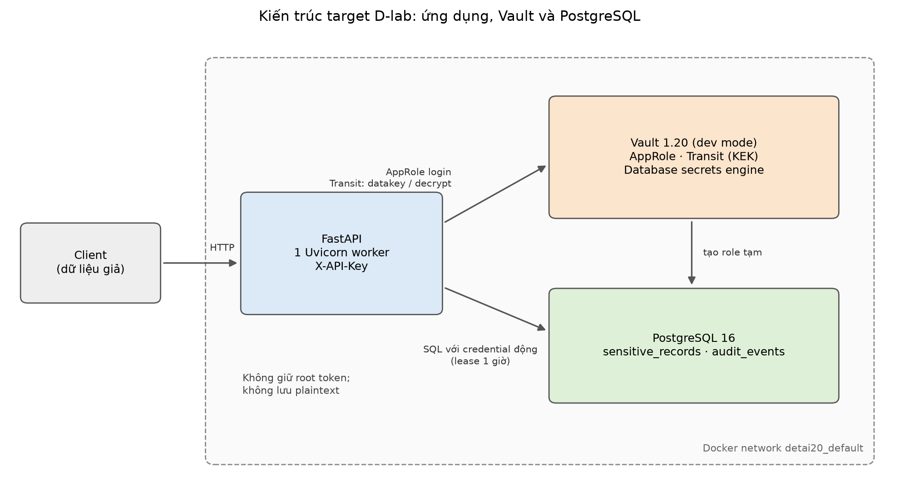
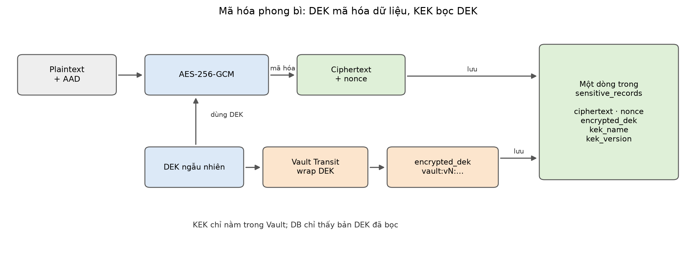
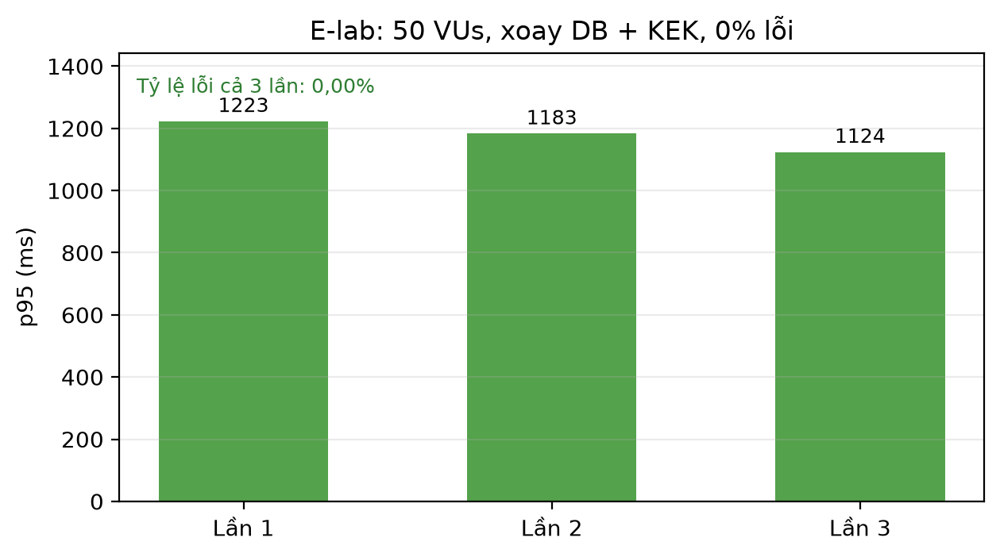
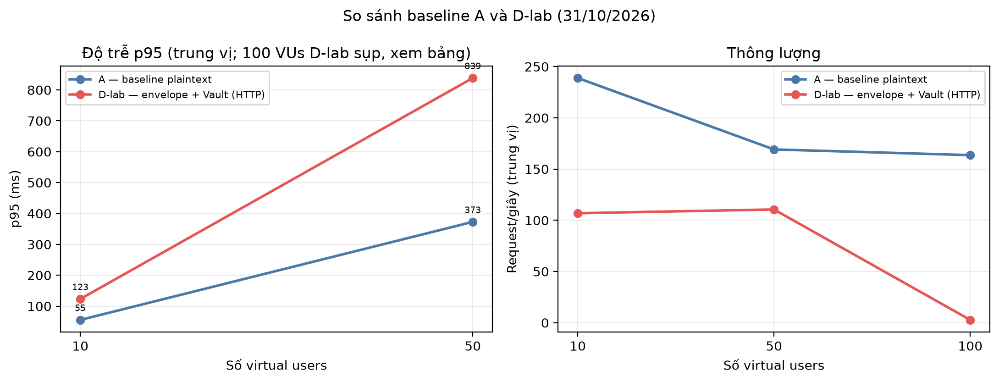

# BÁO CÁO KỸ THUẬT ĐỒ ÁN HỌC PHẦN ĐIỆN TOÁN ĐÁM MÂY

**Đề tài 20: Bảo vệ dữ liệu bằng mã hóa, quản lý khóa và vòng đời bí mật**

Câu hỏi nghiên cứu: *Mã hóa chỉ có ý nghĩa bảo vệ đến đâu nếu khóa, secret ứng dụng và quyền giải mã không được quản lý tách biệt?*

| Hạng mục | Thông tin |
|---|---|
| Trường | Trường Đại học Giao thông vận tải TP.HCM — Khoa Công nghệ Thông tin, Bộ môn Mạng và Hệ thống |
| Học phần | Điện toán đám mây — GVHD: TS. Lê Quốc Tuấn |
| Nhóm | Nhóm 4 — An toàn bảo mật và quản trị đám mây |
| Thành viên | Bùi Ngô Anh Quang (SV3 — Tester/DevSecOps, nhóm trưởng); hothienphu (SV1 — Infra & Security); Nguyễn Minh Hiếu / Hieu0408 (SV2 — Dev & Automation) |
| Mã nguồn | https://github.com/beloncuaem/cloud-computing-detai20 |
| Thời điểm | Tháng 11/2026 |

> **Phạm vi và giới hạn của bản báo cáo.** Hệ thống được xây dựng trong môi trường lab cục bộ (Docker Desktop trên Windows 11), dùng dữ liệu giả hoàn toàn. Vault chạy dev mode một nút, chưa có TLS; PostgreSQL dùng mật khẩu demo và role `vault_admin` có quyền SUPERUSER. Các điểm này được ghi nhận là rủi ro còn lại (Chương 5), không đại diện cho cấu hình production. Báo cáo phân biệt rõ cấu hình đã đo là `D-lab` (envelope encryption qua HTTP) với cấu hình `D` lý thuyết có TLS.

## MỤC LỤC

[[TOC]]

## PHẦN MỞ ĐẦU

### 1. Tính cấp thiết

Dữ liệu trên nền tảng đám mây thường được bảo vệ ở ba trạng thái: khi truyền (in transit), khi lưu trữ (at rest) và khi xử lý (in use/application-level). Trong thực tế, nhiều sự cố rò rỉ không đến từ việc thiếu thuật toán mã hóa mà đến từ việc khóa và secret bị quản lý sai: mật khẩu database hardcode trong mã nguồn, token/API key nằm trong lịch sử Git, khóa mã hóa lưu cùng nơi với dữ liệu, hoặc ứng dụng có quyền giải mã quá rộng. Khi kẻ tấn công lấy được cả ciphertext lẫn khóa, mã hóa gần như không còn giá trị bảo vệ.

Vì vậy, câu hỏi của đề tài không phải "dùng thuật toán nào" mà là "quản lý khóa, secret và quyền giải mã như thế nào để mã hóa thực sự có tác dụng". Đồ án tiếp cận câu hỏi này bằng một nguyên mẫu có thể đo lường: một API lưu trữ thông tin nhạy cảm, sử dụng mã hóa phong bì (envelope encryption), HashiCorp Vault để quản lý khóa và cấp credential động, cùng một đường ống DevSecOps kiểm soát secret trong mã nguồn.

### 2. Mục tiêu cụ thể

1. Triển khai mã hóa phong bì ở tầng ứng dụng: DEK sinh ngẫu nhiên cho từng bản ghi, dữ liệu mã hóa bằng AES-256-GCM, DEK được Vault Transit bọc bằng KEK.
2. Loại bỏ mật khẩu database tĩnh khỏi ứng dụng bằng Vault Database Secrets Engine và AppRole (workload identity).
3. Thiết lập vòng đời bí mật: tạo, phân phối, xoay vòng, thu hồi và ghi audit.
4. Chứng minh tính liên tục khi xoay vòng: credential DB mới được kiểm tra trước khi chuyển pool, credential cũ được giữ đến khi lease hết hạn.
5. Kiểm chứng bằng bộ ca kiểm thử T01–T16, đo hiệu năng bằng k6 ở 10/50/100 VUs và so sánh với baseline plaintext.
6. Tích hợp cổng bảo mật CI (Gitleaks), quy tắc bảo vệ nhánh và cảnh báo bất thường dựa trên audit log.

### 3. Phương pháp luận

Đồ án dùng phương pháp thực nghiệm kiểm soát biến:

- **Baseline (A):** API tối giản lưu plaintext, dùng chung PostgreSQL, không gọi Vault. Baseline chỉ dùng cho đo đạc, không merge vào ứng dụng.
- **Target (D-lab):** ứng dụng thật với envelope encryption, Vault Transit và credential DB tĩnh trong lab; cấu hình `E` bật credential động và xoay vòng.
- **Đo lường:** k6 `constant-vus` ở 10/50/100 VUs, mỗi mức 5 lần, mỗi lần 3 phút; lấy trung vị p95 giữa các lần để giảm nhiễu.
- **Kiểm chứng an toàn:** bộ ca T01–T16, bao gồm round-trip, tamper, AAD binding, phân quyền, audit, quét secret, quy tắc nhánh, TLS, chi phí và cảnh báo.

### 4. Đóng góp và giới hạn

Đóng góp kỹ thuật chính là một nguyên mẫu chạy được, có bằng chứng thực thi cho từng tuyên bố bảo mật, và một bộ công cụ kiểm thử tái lập được (script, compose, k6, checker quyền, cảnh báo audit). Giới hạn: chưa có TLS/HSM, Vault dev mode không bền vững, baseline và target chạy trên cùng một máy cá nhân nên số liệu hiệu năng chỉ có ý nghĩa tương đối; các defect D-01–D-08 được liệt kê công khai thay vì che giấu.

## CHƯƠNG 1: CƠ SỞ LÝ THUYẾT VÀ CÔNG NGHỆ BẢO MẬT ĐÁM MÂY

### 1.1. Ba trạng thái dữ liệu cần bảo vệ

**Data in transit.** Dữ liệu trên đường truyền cần được bảo vệ bằng TLS 1.2/1.3 để chống nghe lén và tấn công man-in-the-middle. TLS bảo vệ kênh, không bảo vệ dữ liệu nếu kẻ tấn công đọc được bộ nhớ hoặc ổ đĩa của ứng dụng.

**Data at rest.** Mã hóa volume (BitLocker, LUKS, EBS encryption) hoặc mã hóa minh bạch ở database (TDE) bảo vệ dữ liệu khi ổ đĩa bị mất hoặc bị sao chép trái phép. Tuy nhiên, nếu khóa giải mã nằm cùng máy chủ hoặc cùng nhà cung cấp, lớp bảo vệ này có thể bị vô hiệu khi toàn bộ hệ thống bị xâm nhập.

**Data in use / application-level.** Dữ liệu nhạy cảm có thể được mã hóa ngay tại ứng dụng trước khi ghi xuống database. Cách này bảo vệ dữ liệu cả khi database bị đọc trộm, miễn là khóa giải mã không nằm trong database. Đây là lớp mà đồ án tập trung triển khai.

### 1.2. Mã hóa phong bì và phân cấp khóa

Mã hóa phong bì dùng hai tầng khóa:

- **DEK (Data Encryption Key):** khóa đối xứng ngắn hạn, sinh mới cho từng bản ghi hoặc từng nhóm dữ liệu, dùng để mã hóa dữ liệu bằng AES-256-GCM.
- **KEK (Key Encryption Key):** khóa lâu dài nằm trong KMS/HSM, dùng để bọc (wrap) DEK. Ứng dụng không lưu KEK; chỉ lưu DEK đã được bọc (`encrypted_dek`).

Luồng ghi:

1. Ứng dụng gọi Vault Transit `datakey/plaintext` để sinh DEK 256 bit.
2. Vault trả về plaintext DEK và ciphertext của DEK (đã bọc bằng KEK).
3. Ứng dụng mã hóa dữ liệu bằng AES-256-GCM với nonce 12 byte và AAD `record_id:record_type`.
4. Ứng dụng lưu `ciphertext`, `nonce`, `encrypted_dek`, `kek_name`, `kek_version`; không lưu plaintext DEK.

Luồng đọc:

1. Đọc bản ghi từ database.
2. Gửi `encrypted_dek` tới Vault Transit `decrypt` để lấy lại plaintext DEK.
3. Giải mã AES-GCM; nếu ciphertext, nonce, AAD hoặc DEK sai, quá trình giải mã thất bại và ứng dụng trả lỗi.

Ưu điểm: dữ liệu lớn không phải gửi lên KMS; KEK không rời khỏi Vault; mỗi bản ghi có DEK riêng nên một DEK bị lộ không làm lộ toàn bộ database. Nhược điểm: mỗi thao tác mã hóa/giải mã cần một lệnh gọi mạng tới Vault, tạo độ trễ và phụ thuộc vào tính sẵn sàng của KMS.

### 1.3. KMS/HSM và quản trị bí mật

**KMS** quản lý vòng đời khóa: tạo, phiên bản hóa, xoay vòng, vô hiệu hóa, xóa. **HSM** là mô-đun phần cứng chuyên dụng, bảo vệ khóa ngay cả khi máy chủ bị xâm nhập; Vault có thể dùng HSM hoặc seal bằng Shamir shares. Trong lab, Vault chạy dev mode với một root token, không có HSM — đây là giới hạn được ghi nhận.

**Secret động** là credential được sinh theo yêu cầu, có thời hạn (lease), thay vì mật khẩu tĩnh dùng mãi. Vault Database Secrets Engine tạo role PostgreSQL tạm thời với TTL, cấp username/password cho ứng dụng, và tự động thu hồi khi lease hết hạn hoặc bị revoke. Cách này thu hẹp cửa sổ tấn công: nếu credential bị lộ, kẻ tấn công chỉ dùng được đến khi lease bị thu hồi.

**Phân tách trách nhiệm.** Người quản trị database không nên nắm quyền giải mã dữ liệu; người quản trị KMS không nên đọc dữ liệu. Ứng dụng chỉ được cấp đúng quyền cần thiết: sinh DEK, giải mã DEK, đọc credential DB — không được xoay KEK, không được đọc metadata khóa, không được export khóa.

**Crypto-shredding.** Khi xóa KEK, mọi `encrypted_dek` trở nên vô dụng, dữ liệu không thể giải mã dù ciphertext vẫn còn. Đây là cách "xóa" dữ liệu hiệu quả khi không thể xóa vật lý.

### 1.4. Rủi ro lộ bí mật và audit trail

Các bề mặt rò rỉ phổ biến:

- Mã nguồn và lịch sử Git chứa mật khẩu, token, private key.
- Docker image layers chứa file `.env` hoặc credential.
- Log ứng dụng ghi plaintext, token, DSN.
- Biến môi trường bị lộ qua `/proc`, dashboard, hoặc dump lỗi.
- Ứng dụng có quyền giải mã quá rộng, hoặc token không hết hạn.

Audit trail của Vault ghi lại mọi request (đã băm token/accessor) gồm đường dẫn, danh tính, thời gian, kết quả. Audit giúp phát hiện hành vi bất thường như số lần giải mã tăng đột biến từ một danh tính. Đồ án dùng audit file device và một script phát hiện ngưỡng 200 request decrypt/60 giây.

### 1.5. Tiêu chuẩn tham chiếu

Báo cáo bám theo NIST SP 800-57 (quản lý khóa), NIST SP 800-145 (định nghĩa cloud), và tài liệu Vault về Transit/Database Secrets Engine. Các khuyến nghị về TLS, least privilege và audit được vận dụng ở mức lab, không tuyên bố tuân thủ đầy đủ FIPS/PCI DSS.

## CHƯƠNG 2: THIẾT KẾ KIẾN TRÚC VÀ RANH GIỚI BẢO MẬT

### 2.1. Phân loại dữ liệu và bề mặt tấn công

Hệ thống mô phỏng một API quản lý thông tin khách hàng, chỉ lưu dữ liệu giả. Bảng phân loại:

| Cấp độ | Ví dụ trường | Rủi ro khi bị xâm phạm | Yêu cầu bảo vệ |
|---|---|---|---|
| Công khai | Tên dịch vụ, mô tả | Thấp | Không cần mã hóa |
| Nội bộ | ID bản ghi, thời gian tạo, loại bản ghi | Ảnh hưởng cấu trúc nội bộ | Kiểm soát truy cập API |
| Nhạy cảm | Số điện thoại, địa chỉ, email | Xâm phạm quyền riêng tư | TLS + mã hóa lưu trữ |
| Bí mật | CCCD, số thẻ, số dư | Hậu quả pháp lý/tài chính | Envelope encryption cấp ứng dụng |

Trong nguyên mẫu, trường `value` (ví dụ `0901234567`) thuộc nhóm nhạy cảm/bí mật và luôn được mã hóa trước khi ghi. `record_type`, `id`, `created_at` là metadata nội bộ, được bảo vệ bằng API key và quyền database.

Bề mặt tấn công chính:

- API công khai: thiếu/sai API key, lạm dụng endpoint admin.
- Ứng dụng: lộ DSN, token Vault, plaintext trong log.
- Vault: root token, policy quá rộng, secret ID không hết hạn.
- Database: role SUPERUSER, backup chứa ciphertext nhưng cũng chứa metadata.
- CI/Git: secret trong commit, image, file cấu hình.
- Vận hành: xoay khóa sai thứ tự làm mất khả năng giải mã.

### 2.2. Kiến trúc baseline (A)

Baseline là một API tối giản, chỉ dùng cho đo đạc:

- Client gọi HTTP tới API.
- API kết nối PostgreSQL bằng DSN tĩnh (`postgresql://postgres:...`).
- Trường nhạy cảm lưu plaintext trong bảng `bench_plaintext_records`.
- Mỗi thao tác ghi/đọc ghi thêm một dòng audit vào `bench_plaintext_audit` để mô phỏng cùng khối lượng DB với target.
- Không có KMS, không mã hóa, không xoay vòng, không audit tập trung.

Lỗ hổng của baseline: đọc được database là đọc được dữ liệu; mật khẩu tĩnh nằm trong cấu hình; không có bằng chứng ai đã giải mã; không có cơ chế thu hồi. Baseline không được merge vào ứng dụng và không dùng cho dữ liệu thật.

### 2.3. Kiến trúc target (D-lab)

Thành phần:

1. **Client** gửi request kèm `X-API-Key` (lab dùng HTTP; production phải dùng HTTPS).
2. **API FastAPI** xác thực API key, gọi Vault, mã hóa/giải mã, ghi database.
3. **Vault** chạy dev mode trong lab:
   - Transit Engine giữ KEK `app-data-key` (AES-256-GCM96), cấp DEK và giải mã DEK.
   - Database Secrets Engine cấp credential PostgreSQL động (khi bật `USE_VAULT_DB_CREDS=true`).
   - AppRole `student2-app` cấp token cho ứng dụng.
   - Audit file device ghi lại request.
4. **PostgreSQL** lưu `ciphertext`, `nonce`, `encrypted_dek`, `kek_name`, `kek_version`, audit ứng dụng; không có cột plaintext.

Luồng dữ liệu:

```text
Client --(API key, HTTP lab)--> FastAPI
FastAPI --(AppRole login)--> Vault
FastAPI --(datakey/plaintext)--> Vault Transit --(KEK app-data-key)--> wrapped DEK
FastAPI --(AES-256-GCM + AAD)--> ciphertext/nonce
FastAPI --(dynamic DB creds, khi bật)--> Vault Database Engine --> PostgreSQL role tạm
FastAPI --(INSERT/COMMIT)--> PostgreSQL
Vault --(audit file)--> /tmp/vault-audit.log
```

{width=100%}

Ranh giới bảo mật:

- Plaintext chỉ tồn tại trong request/response và bộ nhớ API; không ghi log, không ghi DB.
- KEK không rời Vault; ứng dụng chỉ thấy plaintext DEK trong thời gian ngắn.
- Credential DB động có TTL; ứng dụng không lưu mật khẩu tĩnh khi bật chế độ động.
- Endpoint quản trị yêu cầu admin key riêng; app key không đủ quyền.
- Audit là nguồn sự thật để phát hiện hành vi bất thường.

### 2.4. Chính sách phân quyền và vòng đời bí mật

**Mục tiêu least privilege cho AppRole:**

| Path | Quyền mong muốn | Mục đích |
|---|---|---|
| `transit/datakey/plaintext/app-data-key` | update | Sinh DEK |
| `transit/decrypt/app-data-key` | update | Giải mã DEK |
| `database/creds/app-role` | read | Lấy credential DB động |
| `transit/keys/app-data-key/rotate` | **deny** | App không được xoay KEK |
| `transit/keys/app-data-key` | **deny** | Không đọc metadata/version |
| `transit/export/app-data-key` | **deny** | Không export khóa |
| `transit/keys/app-data-key/config` | **deny** | Không sửa cấu hình khóa |

Trạng thái hiện tại: policy trong `setup_vault.py` vẫn cấp `update` cho rotate và `read` cho metadata (defect D-01). Checker `check_approle_privileges.py` phát hiện và trả exit 1; đây là bằng chứng cho thấy kiểm thử bảo mật có tác dụng, đồng thời là việc SV2 phải sửa trước khi tag `v1.0.0`.

**Vòng đời bí mật 5 bước:**

1. **Tạo:** `setup_vault.py` tạo Transit key, mount database, role, policy, AppRole; `vault-init` chạy một lần.
2. **Phân phối:** ứng dụng đăng nhập AppRole bằng `role_id`/`secret_id` từ volume `/credentials`; token có TTL.
3. **Xoay vòng:** DB credential mới được sinh và kiểm tra trước khi chuyển pool; pool cũ giữ đến khi lease hết hạn. KEK xoay bằng operator; DEK được rewrap/re-encrypt (D-03 chưa hoàn chỉnh).
4. **Thu hồi:** lease bị revoke; credential cũ không đăng nhập được. Secret ID/lease bị lộ phải thu hồi và xoay.
5. **Audit:** mọi request Transit/Database được ghi; cảnh báo khi decrypt vượt ngưỡng.

**Mô hình đe dọa tóm tắt:**

| Đe dọa | Biện pháp | Bằng chứng |
|---|---|---|
| Đọc trộm database | Ciphertext + DEK bọc bởi KEK trong Vault | T01, T02, T03 |
| Tráo ciphertext giữa bản ghi | AAD `record_id:record_type` | T04 |
| Dùng API không có quyền | API key + admin key riêng | T05 |
| AppRole bị lạm dụng để xoay/export khóa | Policy least privilege | T06 (đang FAIL do D-01) |
| Xoay khóa làm mất dữ liệu | Giữ version cũ, rewrap, min version | T08 (chờ D-03) |
| Credential DB bị lộ | Dynamic secret + lease TTL/revoke | T09, T10 |
| Secret trong Git/image | Gitleaks + `.dockerignore` + CI | T11, T12, T13 |
| Giải mã bất thường | Audit + cảnh báo 200/phút | T16 |

## CHƯƠNG 3: HIỆN THỰC HÓA NGUYÊN MẪU VÀ TỰ ĐỘNG HÓA LAB

### 3.1. Môi trường và hạ tầng dưới dạng mã

Stack lab gồm PostgreSQL 16, Vault 1.20 (dev mode), vault-audit (bật file audit), vault-init (cấu hình một lần) và API FastAPI. File `docker-compose.yml` ở nhánh `infra/fallback-compose` định nghĩa:

- `postgres`: healthcheck `pg_isready`, volume `pgdata`, chạy script SQL khởi tạo.
- `vault`: `server -dev -dev-root-token-id=root`, healthcheck `vault status`.
- `vault-audit`: bật audit file `/tmp/vault-audit.log`.
- `vault-init`: chạy `scripts/setup_vault.py` với quyền setup, ghi `vault-credentials.json` vào volume `approle`.
- `api`: build từ `student2_project_windows`, nhận biến môi trường, mount volume credential, healthcheck `/ready`.

Các biện pháp tránh lộ secret:

- `.dockerignore` loại `.env`, `vault-credentials.json`, venv, cache.
- Chỉ container `vault-init` nhận root token và mật khẩu DB admin; API không nhận root token.
- `.env` và `vault-credentials.json` nằm trong `.gitignore`; CI quét toàn bộ lịch sử bằng Gitleaks.

### 3.2. Module mã hóa phong bì

Đoạn mã chính trong `app/services/encryption.py`:

```python
def encrypt_sensitive_value(client, plaintext, record_id, record_type):
    response = client.secrets.transit.generate_data_key(
        name=settings.vault_transit_key,
        key_type="plaintext",
        bits=256,
        mount_point=settings.vault_transit_mount,
    )
    data = response["data"]
    dek = base64.b64decode(data["plaintext"], validate=True)
    encrypted_dek = data["ciphertext"]
    nonce = os.urandom(12)
    ciphertext = encrypt_with_dek(
        plaintext=plaintext, dek=dek, nonce=nonce,
        aad=associated_data(record_id, record_type),
    )
    version = int(_VERSION_RE.match(encrypted_dek).group(1))
    return EncryptedPayload(ciphertext, nonce, encrypted_dek,
                            settings.vault_transit_key, version)
```

{width=100%}

Các điểm kỹ thuật quan trọng:

- DEK 32 byte, nonce 12 byte, AES-256-GCM cung cấp confidentiality và integrity.
- AAD gắn ciphertext với `record_id` và `record_type`; tráo ciphertext giữa hai bản ghi sẽ thất bại (T04).
- `encrypted_dek` có dạng `vault:vN:...`; `kek_version` được lưu để truy vết.
- Hàm giải mã gọi Vault `decrypt` để lấy DEK, sau đó giải mã cục bộ; lỗi được ghi audit `decrypt_failed` và trả HTTP 503, không trả chi tiết nội bộ.

Schema `sensitive_records` chỉ có `ciphertext`, `nonce`, `encrypted_dek`, `kek_name`, `kek_version`; không có cột plaintext. Đây là bằng chứng cấu trúc cho T01/T02.

### 3.3. Workload identity và credential động

`app/services/vault_client.py` đọc `role_id`/`secret_id` từ file volume, đăng nhập AppRole và giữ client. Không có root token trong tiến trình API. `app/database.py` hỗ trợ hai chế độ:

- `USE_VAULT_DB_CREDS=false`: DSN tĩnh từ biến môi trường (mặc định lab).
- `USE_VAULT_DB_CREDS=true`: gọi `database/creds/app-role`, tạo engine SQLAlchemy từ username/password động, `pool_recycle` ngắn hơn lease, kiểm tra `SELECT 1` trước khi dùng.

Xoay vòng DB:

```python
new_engine, new_lease_id, new_lease_duration = self._create_engine_from_vault()
with self._lock:
    old_engine = self._engine
    self._engine = new_engine
    self._session_factory = sessionmaker(bind=new_engine, ...)
if old_engine is not None:
    old_engine.dispose(close=False)
```

Pool cũ không bị đóng ngay; connection đang xử lý tiếp tục dùng credential cũ đến khi lease hết hạn. Cách này tạo cửa sổ chồng lấn có chủ đích, tránh lỗi 5xx khi xoay dưới tải (T09). Đổi lại, trong cửa sổ đó tồn tại hai credential hợp lệ; cần ghi rõ trong báo cáo và thu hồi lease cũ khi hết hạn.

### 3.4. Xoay vòng KEK và rewrap

`scripts/rotate_transit_key.py` gọi Vault `transit/keys/app-data-key/rotate` để tạo version KEK mới. `scripts/rotate_dek.py` giải mã từng bản ghi rồi mã hóa lại bằng DEK mới, ghi audit `dek.rotate`; mỗi bản ghi một transaction để lỗi không làm hỏng cả lô.

Hạn chế hiện tại (D-03): chưa có script gọi Vault `transit/rewrap` để bọc lại DEK cũ bằng KEK version mới, và chưa đặt `min_decryption_version` để chặn version cũ. Vì vậy T08 chưa đạt; quy trình đúng phải là: xoay KEK → rewrap toàn bộ DEK → kiểm tra đọc → đặt `min_decryption_version` → kiểm tra ciphertext v1 bị từ chối. Đây là việc của SV2 trước khi nghiệm thu.

### 3.5. DevSecOps: CI, quy tắc nhánh và cảnh báo

**CI:** `.github/workflows/security-gate.yml` chạy hai job:

- `gitleaks`: checkout toàn bộ lịch sử (`fetch-depth: 0`), chạy image `ghcr.io/gitleaks/gitleaks:v8.24.0` với config `.gitleaks.toml`, `--log-opts="--all"`, `--exit-code 1`.
- `unit-tests`: Python 3.12, cài dependencies, chạy `pytest -q`.

**Ruleset `main-1`:** chặn xóa nhánh, chặn force push, bắt buộc PR, cần 1 approval, bắt buộc hai check `gitleaks` và `unit-tests`. Tác giả không có quyền bypass; PR #5 là ví dụ thực tế bị chặn merge khi chưa approve dù CI xanh.

**Cảnh báo:** `scripts/alert_decrypt_rate.py` đọc audit JSONL, lọc request `transit/decrypt/`, đếm cửa sổ trượt 60 giây theo danh tính (`display_name`, `entity_id`, `accessor`), in `ALERT` và exit 2 khi vượt ngưỡng. `scripts/generate_decrypt_load.py` tạo burst 200 decrypt bằng token riêng để kiểm chứng.

**Kiểm thử tự động:** `scripts/smoke-test.ps1` kiểm tra 9 điểm: health, ready, tạo/đọc bản ghi, metadata, thiếu API key, sai API key, admin key, audit. `scripts/check_approle_privileges.py` kiểm tra quyền AppRole bằng `sys/capabilities-self`.

## CHƯƠNG 4: KẾT QUẢ THỰC NGHIỆM, ĐO LƯỜNG VÀ ĐÁNH GIÁ

### 4.1. Thiết kế thí nghiệm và hồ sơ tải

**Môi trường đo:**

| Thành phần | Cấu hình |
|---|---|
| Máy | Windows 11 Home, AMD Ryzen 9 7940HS, 16 GB RAM, Docker Desktop |
| Ứng dụng | FastAPI + Uvicorn một worker, SQLAlchemy 2, psycopg 3 |
| Database | PostgreSQL 16 Alpine trong Docker, volume local |
| Vault | HashiCorp Vault 1.20, dev mode, HTTP nội bộ |
| k6 | grafana/k6:0.54.0 trong Docker Desktop |
| Dữ liệu | Giá trị tổng hợp `090xxxxxxx`, `record_type = bench_phone` |

**Kịch bản k6:** 70% POST `/records`, 30% GET `/records/{id}` của một bản ghi tạo trong `setup()`. Mỗi mức tải 10/50/100 VUs, `constant-vus`, mỗi lần 3 phút, warm-up 1 phút không ghi CSV. Cấu hình target chạy 5 lần mỗi mức (`D-lab`); baseline plaintext chạy 3 lần mỗi mức (`A`). Số liệu báo cáo là trung vị p95 giữa các lần; CSV thô được nén lossless và lưu cùng `_summary.json`.

**Vì sao gọi `D-lab`:** hệ thống chưa có TLS và chưa có mã hóa volume; do đó không được ghi kết quả này là cấu hình `D` đầy đủ trong báo cáo. `D-lab` đo phần envelope encryption + gọi Vault qua HTTP nội bộ, là **cận dưới** của chi phí mã hóa (chưa gồm TLS).

### 4.2. Kết quả kiểm thử chức năng và bảo mật

| Ca | Nội dung | Kết quả | Bằng chứng |
|---|---|---|---|
| T01 | Envelope round-trip | ĐẠT | `T01_T05_T07_2026-10-31.md` |
| T02 | Không plaintext trong DB/dump/log/image | ĐẠT (cả 4 vị trí đều 0) | `T02_plaintext_probe_2026-10-31.md` |
| T03 | Ciphertext bị sửa → 503 + audit | ĐẠT | `T03_T04_tamper_2026-10-31.md` |
| T04 | AAD binding, tráo payload → 503 | ĐẠT | cùng tệp |
| T05 | API key/admin key | ĐẠT (401/401/403) | `T01_T05_T07_2026-10-31.md` |
| T06 | AppRole least privilege | **CHƯA ĐẠT — D-01** | `T06_T08_2026-10-31.md` |
| T07 | Audit Transit/Database, 0 plaintext | ĐẠT | `T01_T05_T07_2026-10-31.md` |
| T08 | Xoay KEK + rewrap + chặn version cũ | **CHƯA ĐẠT — D-03** | `T06_T08_2026-10-31.md` |
| T09 | Xoay credential DB dưới tải | ĐẠT (20 VUs/1 phút và E-lab 50 VUs/3 phút, 0 lỗi) | `T09_T10_db_credentials_2026-10-31.md`; `E-lab_rotation_2026-10-31.md` |
| T10 | Lease renew/revoke | ĐẠT | cùng tệp |
| T11 | Gitleaks lịch sử + secret giả | ĐẠT (14 commit, 0 leak; fake bị bắt) | `T11_T12_2026-10-31.md` |
| T12 | Ruleset bảo vệ `main` | ĐẠT (PR + 1 approval + 2 check) | cùng tệp; ảnh cần chụp |
| T13 | TLS + at rest | **CHƯA ĐẠT** (chưa có TLS) | `T13_partial_2026-10-31.md` |
| T14 | Benchmark 10/50/100 VUs | ĐẠT MỘT PHẦN — A/D-lab/E-lab; H1 bị bác bỏ; thiếu B/C/D đầy đủ | `T14_benchmark_2026-10-31.md` |
| T15 | Dọn tài nguyên/tái lập | ĐẠT (trong phạm vi nhánh dự phòng): dựng lại 24 s, smoke 9/9, dọn sạch | `T15_reproducibility_2026-10-31.md` |
| T16 | Cảnh báo decrypt bất thường | ĐẠT | `T16_alert_2026-10-31.md` |

**Bằng chứng an toàn nổi bật:**

- Bảng `sensitive_records` chỉ có `ciphertext` 26 byte, `nonce` 12 byte, `encrypted_dek` prefix `vault:v1:`; không có cột plaintext (T01).
- Sửa một byte ciphertext hoặc tráo payload giữa hai bản ghi đều trả HTTP 503; audit ghi `record.read`/`failure`/`decrypt_failed` (T03, T04).
- API không có key trả 401; dùng app key cho endpoint admin trả 403 (T05).
- Gitleaks quét 14 commit, 0 leak; token GitHub giả trong thư mục tạm bị phát hiện với rule `github-pat` (T11).
- T16: tải nền 10 phút có 1.478 request, 0 lỗi, 469 decrypt từ AppRole, không cảnh báo; burst 200 decrypt từ token riêng bị phát hiện trong 0,4 giây (ngưỡng 200/60 giây).

**Các defect còn mở (công khai, không che giấu):**

| Mã | Mô tả | Tác động | Người sửa |
|---|---|---|---|
| D-01 | Policy AppRole còn `update` rotate và `read` metadata KEK | App có thể xoay/đọc metadata khóa, vi phạm least privilege | SV2 |
| D-02 | `secret_id_ttl=0s`, `secret_id_num_uses=0` | Secret ID không hết hạn, dùng lại vô hạn | SV2 |
| D-03 | Chưa rewrap/khóa version cũ | Xoay KEK chưa hoàn chỉnh vòng đời | SV2 |
| D-04 | Vault dev mode, HTTP, root token trong lab | Không dùng production | SV1/SV3 |
| D-05 | `vault_admin` là SUPERUSER PostgreSQL | Rủi ro leo thang quyền trong lab | SV1 |
| D-06 | `.vscode/settings.json` còn tracked | Nhiễu repo, không phải secret | SV2/SV3 |
| D-07 | Baseline plaintext dựng riêng | Chỉ dùng đo H1, không merge vào app | SV3 |
| D-08 | Pool 5+10, một Uvicorn worker; connection bị giữ trong lúc gọi Vault | Trần ~110 RPS, 100 VUs sụp; chưa scale ngang | SV2/SV3 |

### 4.3. Tính liên tục khi xoay vòng

**Kết quả đo được (T09):** k6 20 VUs trong 1 phút, gọi `POST /admin/rotation/database` sau 20 giây. Kết quả 6.399 request, checks 100%, `http_req_failed = 0.00%`, p95 = 250,52 ms. API trả `status = rotated`, `new_lease_duration_seconds = 3600`; role động mới xuất hiện trong `pg_roles`; role cũ còn hiệu lực đến khi lease hết hạn (overlap có chủ đích).

**Kết quả đo được (E-lab):** 3 lần 50 VUs trong 3 phút, mỗi lần xoay credential DB ở giây 60 và xoay KEK ở giây 120. Trung vị 77,34 RPS, p95 1.183,01 ms, 0,00% lỗi; cả 6 thao tác xoay trả HTTP 200 trong 0,164–0,517 s và API ghi 3 lần `Switched database pool`, không có phản hồi 5xx. Chi tiết ở `docs/evidence/E-lab_rotation_2026-10-31.md`.

{width=80%}

**So sánh với cách truyền thống:** phương pháp thủ công (đổi mật khẩu DB + restart API) buộc connection pool cũ đóng và tạo cửa sổ lỗi 502/503 trong vài giây. Đồ án **chưa đo trực tiếp** cửa sổ downtime thủ công trên cùng máy; do đó báo cáo không đưa ra con số 3–12 giây như một kết quả thực nghiệm. Kết luận định lượng chỉ là: với cách Vault, trong 3 phút có 0 lỗi, 0 phản hồi 5xx và 0 downtime quan sát được.

**Lưu ý về KEK:** xoay KEK chỉ tăng version; bản ghi cũ vẫn giải mã được bằng version cũ vì chưa có rewrap và `min_decryption_version` (D-03). Vì vậy E-lab chứng minh "xoay không gián đoạn", chưa chứng minh "hoàn tất vòng đời khóa".

**Giới hạn:** API chạy một Uvicorn worker; cơ chế đổi engine trong bộ nhớ là process-local. Nếu scale nhiều worker/replica, cần cơ chế phối hợp (reload tín hiệu, sidecar, hoặc rolling restart có health check) thay vì swap trong bộ nhớ.

### 4.4. Đo lường hiệu năng và chi phí đánh đổi

Bảng dưới được điền từ `bench/results/` bằng `bench/analyze.py`. **A** là baseline plaintext, **D-lab** là envelope encryption + Vault qua HTTP, **E-lab** là D-lab có xoay credential DB và KEK:

| Mức tải | Cấu hình | RPS | p50 (ms) | p95 (ms) | p99 (ms) | Error rate |
|---:|---|---:|---:|---:|---:|---:|
| 10 VUs | A | 238,90 | 42,22 | 55,46 | 61,49 | 0,00% |
| 10 VUs | D-lab | 106,87 | 93,23 | 123,24 | 141,37 | 0,00% |
| 50 VUs | A | 169,14 | 293,83 | 372,90 | 435,03 | 0,00% |
| 50 VUs | D-lab | 110,55 | 393,40 | 838,68 | 1.140,35 | 0,00% |
| 100 VUs | A | 163,61 | 610,63 | 704,61 | 773,67 | 0,00% |
| 100 VUs | D-lab | 2,73 | 30.803,10 | 59.995,57 | 59.995,76 | 50,10% |
| 50 VUs | E-lab | 77,34 | 555,73 | 1.183,01 | 1.608,78 | 0,00% |

Số của D-lab là **trung vị của 5 lần chạy** mỗi mức, lấy từ `bench/results/D-lab_*_run{1..5}.csv.gz` bằng `bench/analyze.py`; cột lỗi là trung vị tỷ lệ `http_req_failed`. Ở 100 VUs, cả 5 lần đều vượt ngưỡng lỗi (cao nhất 61,12%) và p95 xấp xỉ timeout 60 giây của k6: đây là **sụp bão hòa**, không phải một cấu hình chạy được, nên không dùng để tính overhead H1. Dòng E-lab là **trung vị 3 lần chạy** có xoay vòng, dùng cho H2 chứ không dùng tính H1.

{width=100%}

**H1 — overhead p95 ≤ 30% so với baseline: BỊ BÁC BỎ.** Ở hai mức tải đo được hợp lệ, overhead là **+122,21%** ở 10 VUs và **+124,91%** ở 50 VUs; mức 100 VUs không dùng để kết luận H1 vì D-lab sụp bão hòa (p95 xấp xỉ timeout 60 giây). Ngay ở mức tải thấp nhất, p95 tăng hơn gấp đôi, gấp khoảng 4 lần ngưỡng 30%. Đồng thời RPS giảm từ 238,90 xuống 106,87 ở 10 VUs và từ 169,14 xuống 110,55 ở 50 VUs. Nguyên nhân chính là mỗi request tạo gọi Vault `transit/datakey` để sinh DEK, mỗi request đọc gọi `transit/decrypt`; 70% tải là tạo. Vault, PostgreSQL và API dùng chung CPU của một máy; API chạy một Uvicorn worker với pool 5+10. Vì vậy không thể tuyên bố overhead chấp nhận được; cần cấu hình D' (sinh DEK theo lô/cache DEK cho bản ghi nóng, tăng pool, nhiều worker/replica, đặt Vault gần app) và đo lại trước khi dùng production. Cần phân biệt rõ đây là `D-lab` chưa có TLS; cấu hình `D` thật sẽ còn overhead TLS.

**Quan sát bão hòa:** D-lab tăng từ 106,87 lên 110,55 RPS khi tải từ 10 lên 50 VUs, trong khi p95 tăng từ 123 ms lên 839 ms; nghĩa là hệ thống đã chạm trần khoảng 110 RPS. Ở 100 VUs, log API ghi `QueuePool limit of size 5 overflow 10 reached, connection timed out, timeout 30.00` và trả 503; p95 60 giây là timeout của k6, không phải thời gian xử lý thực. Đây là bằng chứng cho D-08 (pool 5+10, một worker, connection bị giữ trong lúc gọi Vault) và cho thấy H1 chỉ có thể xét ở 10/50 VUs.

**H2 — lỗi < 0,1% khi xoay vòng: ĐẠT.** T09 đạt 0% ở 20 VUs/1 phút; E-lab lặp lại 3 lần ở 50 VUs/3 phút với 3 lần xoay credential DB và 3 lần xoay KEK, tất cả 0,00% lỗi, 0 phản hồi 5xx. E-lab chưa có TLS nên chỉ là `E-lab`, không phải cấu hình E đầy đủ.

**H3/H4:** T11 đạt (0 leak, fake bị bắt); T02 đạt (0 plaintext trong DB/dump/log/image); T16 đạt (không báo nhầm, bắt burst).

### 4.5. Thảo luận và hiệu lực đo

- Số liệu trên máy cá nhân, cùng một ổ đĩa và Docker Desktop; không suy diễn sang production.
- Chưa đo CPU theo từng run; bảng CPU trong khung báo cáo được thay bằng mô tả môi trường và RPS/p95. Nếu cần CPU, chạy `docker stats` song song và ghi rõ thời điểm lấy mẫu.
- Baseline dùng chung PostgreSQL nhưng bảng riêng, không gọi Vault; đây là so sánh "cùng DB, khác lớp mã hóa", không phải so sánh hai hệ thống độc lập.
- Kết quả p95 ở 10 VUs cao hơn kỳ vọng do mỗi request phải chờ Vault + commit DB; đây là chi phí thật của kiến trúc, không phải lỗi đo.
- Các ca T06/T08/T13 chưa đạt là bằng chứng trung thực cho thấy hệ thống chưa hoàn thiện; không được tag `v1.0.0` khi các defect này còn mở.

## CHƯƠNG 5: QUẢN TRỊ RỦI RO, ỨNG PHÓ SỰ CỐ VÀ DỰ TOÁN CHI PHÍ

### 5.1. Kế hoạch ứng phó sự cố

| Tình huống | Phát hiện | Ứng phó | Khôi phục |
|---|---|---|---|
| Lộ KEK | Audit bất thường, cảnh báo decrypt | Xoay KEK, rewrap toàn bộ, khóa version cũ, thu hồi token/lease liên quan | Kiểm tra audit, xác nhận không còn version cũ được chấp nhận |
| Lộ AppRole secret ID | Audit login bất thường | Thu hồi secret ID/lease, tạo secret ID mới, siết policy | Kiểm tra log, xoay credential DB |
| Lộ mật khẩu DB động | Audit database/creds bất thường | Revoke lease ngay, xoay role | Tạo lease mới, kiểm tra kết nối |
| Mất unseal key/root token | Vault không unseal được | Khôi phục từ Shamir shares/backup; nếu mất hoàn toàn, dữ liệu coi như không giải mã được | Chấp nhận mất dữ liệu theo chính sách hoặc phục hồi backup |
| Rò rỉ secret trong Git | Gitleaks CI fail | Chặn merge, xóa secret khỏi lịch sử (nếu đã push), xoay secret | Quét lại toàn bộ lịch sử |
| Tấn công giải mã hàng loạt | Alert > 200 decrypt/60s | Cô lập danh tính, thu hồi token/lease, điều tra | Xoay khóa nếu cần |

### 5.2. Rủi ro còn lại

- **Plaintext trong RAM:** ứng dụng phải giải mã dữ liệu để trả cho client; RAM và swap có thể chứa plaintext. Cần Confidential Computing hoặc giảm thời gian sống của plaintext.
- **Vault dev mode:** storage trong RAM, một nút, root token `root`, không có HA/backup. Mất container là mất khóa/audit.
- **HTTP trong lab:** chưa có TLS; dữ liệu và API key có thể bị nghe lén trên mạng. Đây là lý do T13 chưa đạt.
- **`vault_admin` SUPERUSER:** dùng để đơn giản hóa lab; production phải tách quyền và dùng role tối thiểu.
- **D-01/D-02/D-03:** policy AppRole còn rộng, secret ID không hết hạn, thiếu rewrap/min version. Đây là các defect phải đóng trước nghiệm thu.
- **Một worker:** cơ chế rotation trong bộ nhớ không scale ngang; cần thiết kế lại cho nhiều replica.
- **Không có backup tự động:** chưa có snapshot Vault/DB định kỳ; cần bổ sung trước khi dùng thật.
- **Baseline D-07:** baseline chỉ để đo, không phải hệ thống production; không được nhầm với ứng dụng.

### 5.3. Dự toán chi phí

**Trong lab:** chi phí cloud bằng 0; tài nguyên là máy cá nhân (Ryzen 9 7940HS, 16 GB RAM), Docker Desktop, các image mã nguồn mở.

**Nếu chuyển lên cloud,** các thành phần cần tính:

| Thành phần | Đơn vị tính giá | Ghi chú |
|---|---|---|
| Compute cho API | giờ máy ảo/container | 1–2 vCPU, 2–4 GB RAM cho tải nhỏ |
| PostgreSQL | giờ instance + dung lượng + backup | Managed DB hoặc self-host |
| KMS/Vault | số key + số request + giờ HSM (nếu dùng) | Transit tương đương KMS |
| Secrets Manager | số secret + số API call | Credential động làm tăng số call |
| Object storage/backup | GB-tháng | Snapshot Vault + DB |
| Logging/monitoring | GB log + retention | Audit log tăng theo lưu lượng |
| Băng thông | GB ra ngoài | Thường nhỏ trong lab |

Không đưa ra con số tuyệt đối vì bảng giá thay đổi theo nhà cung cấp/khu vực; khi lập dự toán chính thức, cần tra bảng giá hiện hành của AWS/GCP/Azure và ghi ngày truy cập. Định hướng tối ưu: cache DEK ngắn hạn để giảm gọi KMS, gộp audit, dùng reserved/savings plan cho compute, và chỉ bật HSM khi có yêu cầu tuân thủ.

## KẾT LUẬN VÀ HƯỚNG PHÁT TRIỂN

### 1. Kết quả đạt được

Đồ án đã xây dựng được một nguyên mẫu mã hóa phong bì có bằng chứng thực thi: dữ liệu nhạy cảm chỉ lưu dưới dạng ciphertext, DEK được Vault bọc, AAD chống tráo payload, API key/admin key tách biệt, audit ghi nhận truy cập, credential DB động có lease và thu hồi được, CI quét secret và ruleset chặn push trực tiếp. Các ca T01–T05, T07, T09–T12, T16 đạt; T06/T08/T13 chưa đạt do defect và giới hạn lab được ghi nhận công khai.

### 2. Bài học

Mã hóa chỉ có giá trị khi khóa và quyền giải mã được tách khỏi dữ liệu và khỏi ứng dụng. Một hệ thống có thể dùng AES-256-GCM nhưng vẫn mất an toàn nếu policy AppRole quá rộng, secret ID không hết hạn, hoặc audit không được giám sát. Ngược lại, một chút chi phí hiệu năng (gọi Vault, kiểm tra credential) là đánh đổi hợp lý để loại bỏ rủi ro lộ plaintext. Bài học thứ hai là phải đo và ghi lại cả thất bại: các defect D-01–D-08 và các ca chưa đạt là một phần của kết quả nghiên cứu, không phải điều cần che giấu.

### 3. Hướng phát triển

- Bổ sung TLS/mTLS, Vault file storage + HA, backup/unseal an toàn.
- Đóng D-01/D-02/D-03: policy tối thiểu, secret ID TTL/num_uses, rewrap + `min_decryption_version`.
- Cache DEK có kiểm soát để giảm độ trễ, đo lại H1.
- Chạy baseline và target trên máy tách biệt hoặc cùng cluster có giới hạn tài nguyên, đo CPU/RAM chính xác.
- Tích hợp HSM/Confidential Computing, service mesh, và cảnh báo real-time thay vì script đọc audit.

## TÀI LIỆU THAM KHẢO

1. TS. Lê Quốc Tuấn (2024), *Bài giảng Học phần Điện toán Đám mây — Chương 4: An toàn, Bảo mật và Quản trị Cloud*, Trường ĐH Giao thông vận tải TP.HCM.
2. NIST (2011), *SP 800-145: The NIST Definition of Cloud Computing*.
3. NIST (2020), *SP 800-57 Part 1 Rev. 5: Recommendation for Key Management*.
4. HashiCorp, *Vault Documentation: Transit Secrets Engine; Database Secrets Engine; AppRole Auth Method*.
5. Dan C. Marinescu (2017), *Cloud Computing: Theory and Practice*, 2nd Edition, Morgan Kaufmann.
6. OWASP, *Secrets Management Cheat Sheet*.

## PHỤ LỤC

- **Phụ lục A:** `docker-compose.yml`, `scripts/setup_vault.py`, `app/services/encryption.py`, `app/database.py`.
- **Phụ lục B:** `bench/results/*.csv.gz`, `*_summary.json`, bảng `analyze.py`.
- **Phụ lục C:** `docs/evidence/*.md`, ảnh chụp và video demo.
- **Phụ lục D:** `docs/testing/test-plan.md` (T01–T16, H1–H4, defect log).

